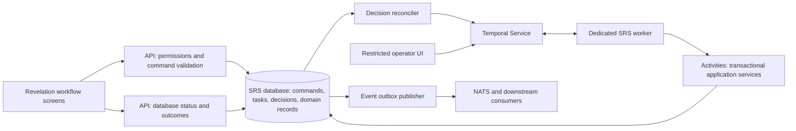

# Plan: live Temporal execution in Revelation SRS

Date: 11 November 2026 (revised the same day after review). Status: **Stages 0–4 implemented;
Stage 5 partly; Stage 6a implemented (16 November 2026); Stage 6b out of scope.** See [Implementation progress](#implementation-progress).
Decisions: [ADR-024](../decisions/ADR-024-live-temporal-execution.md).
Baseline: the working tree as of commit `3d68f04`, including the generic workflow builder and Task Inbox.

## At a glance

- **Goal:** approval processes survive restarts, wait durably for people, enforce deadlines
  and retry recoverable failures. Staff keep using Revelation screens; Temporal runs underneath.
- **Do first, independent of Temporal:** fix the module-registration change decision, which
  currently closes the workflow before the registration change is made (see Stage 0).
- **Upgrade Temporal now:** no Temporal executions exist yet, so moving from server 1.24 to a
  current release costs nothing today and removes most later upgrade risk.
- **Keep the reliability core small:** a unique decision row per task revision, a Temporal
  signal, and a reconciler that re-sends pending decisions. No general-purpose command
  dispatcher unless the pilot shows it is needed.
- **Pilot:** generic single-review workflows, then module-registration change approval.
- **Separate workstream:** a platform-wide event outbox. The silent event loss it fixes affects
  every service, not only workflows.
- **Open decisions for the Stage 0 ADR:** namespace model, synchronous (Update) versus
  asynchronous (Signal + `202`) decision acceptance, and which process families Stage 6 covers.

## Implementation progress

Updated 11 November 2026. Sections after this one are the plan as reviewed; where the
implementation chose between options, ADR-024 records the choice.

| Stage | Status | Evidence |
|---|---|---|
| 0. Fix, upgrade, freeze contracts | **Done** | `decideChangeRequest` applies the change before closing (regression test in `module-registrations.int.test.ts`). SDK 1.25.0, Server 1.32.2, UI 2.58.1 pinned. ADR-024 settles the namespace model (one per environment), acceptance model (Update, falling back to saved command + `202`) and Stage 6 scope. Inventory below. |
| 1. Real application worker | **Done** | `apps/api/src/worker.ts`: real activities, graceful drain, reconciler loop, `/ready` that reflects polling. Startup fails if an activity is missing. `workflow:smoke` passed against local Compose Temporal, including a worker restart that resumed the same execution. k8s worker manifest runs it from the API image with probes. |
| 2. Retry-safe writes and delivery | **Done** | Migration `0023`: execution metadata, task revisions, `workflow_command`, `workflow_operation_receipt`, `workflow_event_outbox`, rollout flag (default off). Each effect commits with its receipt, audit row and events. The reconciler starts saved reviews and re-delivers saved commands. Legacy instances were backfilled as `legacy` by default. |
| 3. Generic reviews | **Done** | `reviewWorkflow` keeps real outcomes, absolute deadlines, escalation that keeps waiting, needs-attention, cancellation and queries. Start, decide and cancel routes pick the backend per instance. Task Inbox shows saved/applied/needs-attention states. |
| 4. Module registration pilot | **Done** | Approvals apply as an idempotent domain effect (registration ID derived from the command). Failures keep the decision visible and reopen the request. Workflow completion follows the domain change. |
| 5. Recovery and release | **Partly** | Done: 9 time-skipping/replay workflow tests; 18 real-server integration tests (worker restart, Temporal unreachable at start, decision during worker outage, concurrent decisions, deadline races, forged/cross-tenant commands, outbox while NATS down); runbook 04 rewritten; `/ready` no longer fails on Temporal. **Not done:** load test against the 500 ms p95 target, NATS/database-restore drills, alert rules for the backlog metrics, Worker Versioning, UAT rehearsal of flag rollback. |
| 6. Expand by family | **6a done; 6b out of scope** | All eight bridge-caller families start on Temporal when flagged (coverage matrix below), through one helper, `GovernedReview` (`platform-controls/governed-review.ts`). Each family's business change is a worker effect, idempotent per decision: HESA skips a return already submitted; OfS derives the extract ID from the command; SLC, UCAS and UKVI process only triggers still pending, and UKVI derives each CAS request ID from its trigger; legal identity skips a change already in place; module selection resumes an interrupted approval at confirmation, with registration IDs derived from the proposal item. Admissions has no decision service, so its hand-off is decided in the Task Inbox like any review. Decide routes return `202` with a command ID when the decision is saved but not yet applied. **The legacy bridge now applies the change before it closes the request** in all eight families. Previously it closed first, so a failed change left a completed request with nothing applied: the bug Stage 0 fixed for module registration. Tests: `temporal-stage6a.int.test.ts` (10: effect coverage for every family; legal identity applied once, rejected, failed and retried, own-request authority; OfS and SLC exactly once under replay; module selection approved once under replay and rejected; legacy failure leaves the request open). **Not done:** dedicated Temporal tests for HESA, UCAS, UKVI and admissions (they share the helper and are covered by the effect-coverage check), and pending-state messages on the family admin pages (they reload and show the request still open; the Task Inbox already shows pending). |

### Coverage matrix (Stage 0 inventory)

| Workflow family | Code | Engine owner today | Status |
|---|---|---|---|
| Builder-authored single reviews | (per definition) | Bridge → **Temporal when flagged** | Migrated (Stage 3) |
| Module registration change | `module-registration-change-approval` | Bridge → **Temporal when flagged** | Migrated (Stage 4) |
| Module selection | `module-selection-approval` | Bridge → **Temporal when flagged** | Migrated (Stage 6a) |
| Legal identity change | `legal-identity-change-approval` | Bridge → **Temporal when flagged** | Migrated (Stage 6a) |
| Admissions hand-off | per source (`SOURCE_WORKFLOW`) | Bridge → **Temporal when flagged** | Migrated (Stage 6a) |
| HESA return submission | `hesa-return-submission-approval` | Bridge → **Temporal when flagged** | Migrated (Stage 6a) |
| OfS extract generation | `ofs-extract-generation-approval` | Bridge → **Temporal when flagged** | Migrated (Stage 6a) |
| SLC confirmation submission | `slc-confirmation-submission-approval` | Bridge → **Temporal when flagged** | Migrated (Stage 6a) |
| UCAS confirmation submission | `ucas-confirmation-submission-approval` | Bridge → **Temporal when flagged** | Migrated (Stage 6a) |
| UKVI CAS request submission | `ukvi-cas-request-submission-approval` | Bridge → **Temporal when flagged** | Migrated (Stage 6a) |
| PGR, DSAR, identity resolution | — | `business_case` (ADR-023) | Out of scope (6b, needs its own ADR) |
| Wellbeing cases | — | `modules/wellbeing` state machines | Out of scope (6b, needs its own ADR) |

### Known limitations

- The rollout flag and `TEMPORAL_EXECUTION_ENABLED` are both off by default. Nothing
  runs on Temporal until a deployment enables both and runs a worker.
- An escalation fires once; there is no repeating escalation cycle (as planned).
- Deadlines use elapsed time; there is no working-day calendar (as planned).
- The k8s server manifest was updated to `temporalio/server:1.32.2` but not deployed
  here; its config template and start command need checking against that image.
- Other services still publish events directly, so they can still lose events while
  NATS is down. Only workflow events use the outbox.

## Purpose and intended result

Make Revelation's approval processes continue reliably after an API or worker restart,
wait durably for human decisions, enforce deadlines, and retry recoverable failures.
Staff continue using Revelation to create reviews, receive tasks and record decisions.
Temporal supplies execution and recovery; its own UI is an operator diagnostic tool.

Start with the existing generic, single-review workflows. Then migrate one process
that changes a business record: module-registration change approval. Extend to other
processes only after those two paths demonstrate recovery and correct outcomes.

The result must preserve the separation in [ADR-015](../decisions/ADR-015-workflow-feature-flags-and-environment-promotion.md)
and [ADR-016](../decisions/ADR-016-authoritative-business-state-and-workflow-separation.md):
domain services own academic and regulatory facts; Revelation's database owns task and
decision records; Temporal coordinates their execution. Workflow completion must never
stand in for a successfully committed business change.

This plan does not add a graphical process designer, arbitrary scripts, multi-step
authoring, automatic event-triggered workflows or institution-specific approval policy.
Those can build on the execution foundation later. Existing draft work in the repository
is an input to this plan and must be preserved.

## Verified starting point

| Area | Current implementation | Integration consequence |
|---|---|---|
| Infrastructure | `infra/compose/docker-compose.yml` declares Temporal Server `1.24` (`auto-setup`) and UI `2.51.0`. | Infrastructure configuration is present; this review did not verify a running server or worker. No executions exist, so the server can be upgraded without migrating work. |
| SDK package | `packages/workflow/package.json` declares `^1.11.0`; `pnpm-lock.yaml` resolves all `@temporalio/*` packages to `1.17.2`. Client helpers can start, signal and query. | The SDK is far newer than the server. Upgrade the server to a release supported by SDK 1.17 before relying on Updates or Worker Versioning. |
| Worker | `packages/workflow/src/worker.ts` creates a worker; its standalone entry point supplies unconfigured workflow and audit activities. | A real application worker needs database, audit and event-publication implementations and its own lifecycle. |
| Application | `apps/api/src/app.ts` constructs `WorkflowBridgeService`; domain services call it directly. Bridge callers: students, the five regulatory services (HESA, OfS, SLC, UCAS, UKVI), module registration, module selection and admissions, plus the escalation sweep. Nothing in `apps/` or `modules/` imports `@temporalio` or the workflow package. | Add an explicit runtime boundary and migrate selected entry points. Merely starting the existing worker will not integrate the application. |
| Other process engines | PGR, DSAR and identity resolution run on `business_case` (ADR-023), not the workflow bridge. Wellbeing cases use their own state machines in `modules/wellbeing`. | These are not bridge migrations. Stage 6 must decide explicitly whether, and how, they come under Temporal. |
| Workflow scaffold | `packages/workflow/src/workflows/index.ts` provides `genericHumanTaskWorkflow`. It always records `approved`, only arms a timeout for `dueAfterMs`, returns after escalation, and escalates to the task's existing `assigneeRoleCode` rather than a configured escalation role. | Replace the pilot execution contract to preserve actual decisions, handle absolute deadlines, escalate to the configured role and allow that recipient to respond. |
| Persistence | `workflow-bridge-service.ts` inserts instances, tasks and decisions without operation-level deduplication. State, event publication and audit use separate calls. | Harden activity effects before allowing Temporal to retry them. |
| Event publication | When NATS is disconnected, `#publishWorkflowEvent` returns without publishing or saving the event. There is no platform-wide event outbox; only the wellbeing module has handoff outboxes. | Silent event loss affects every publishing service. Fix it for workflow events in this plan; treat the platform-wide outbox as a separate workstream. |
| Public commands | `routes/platform-controls.ts` directly creates/completes records; task completion currently returns `204`. | Add durable command acceptance and explicit asynchronous status for migrated instances. |
| Deadline sweep | `workflow-escalation-service.ts` selects overdue tasks, then mutates each through the bridge. Nothing schedules it; it runs only from a manual platform-controls route. | Legacy instances have no automatic deadline handling today, so Temporal timers will be the first. A status filter alone does not protect simultaneous sweep/decision requests; enforce transitions atomically and give each instance one timer owner. |
| Domain ordering | `platform/registration/service.ts::decideChangeRequest` records the decision, completes the task and marks the instance `completed` before calling the registration/withdrawal operation. If that operation fails, the request is closed with no change and cannot be retried, because decisions require status `running`. | This is a current defect, not only a migration risk. Fix it in Stage 0, before any Temporal work. |
| Readiness | `routes/health.ts` checks Temporal TCP connectivity. | A reachable port is not evidence of a worker polling the correct namespace and queue. |

Read [the workflow guide](../user-guides/workflow-engine-and-revelation-srs.md) for the
existing user journey. The [integration patterns](workflow-engine-integration.md) and
[recovery runbook](../runbooks/04-workflow-recovery.md) describe intended capabilities;
their production assumptions must be reconciled with each delivered stage.

## Architecture and ownership

The "durable command dispatcher" starts as a simple reconciler: a background job that finds
saved commands not yet confirmed by Temporal and sends them again. An outbox is a database
table of work saved in the same transaction as the change that requires it. This closes the
gap between saving a request and contacting Temporal or NATS. It does not make those systems
share one transaction.

- **API:** authenticate the actor; verify tenant, deployment environment, subject access,
  published definition, assignment and decision options. Persist a validated request.
  Do not trust caller-supplied roles, workflow code, environment or task configuration
  when these can be derived from the authorised definition and deployment.
- **Temporal:** owns ordering, waiting, retry scheduling and timers for migrated
  instances. Workflow code performs no database or network access directly.
- **Activities:** call transactional application services. Domain services still enforce
  current capacity, registration windows, record versions and other invariants.
- **Database:** retains authoritative records, accepted commands, immutable decisions,
  operation receipts and the UI status projection. It remains readable during an
  execution outage. Distinguish a human decision from its application to a record.
- **NATS:** continues distributing domain events. Temporal is not a replacement event bus.
  Events become eligible for publication only after their domain transaction commits.

## Reliability contract to implement first

### Identity, isolation and versioning

Add execution metadata to each instance: immutable backend (`legacy` or `temporal`),
environment, namespace, task queue, stable Temporal workflow ID, observed run ID,
definition version, execution-contract version and worker build/deployment version.
Keep execution status separate from the business outcome. Capture run changes as
history; a reset must not overwrite the original execution linkage.

Use a stable, opaque identifier such as `srs:<environment-id>:<tenant-id>:<instance-id>`.
Persist start-command identity before calling Temporal. Duplicate delivery must find the
same execution, including after completion; configure an explicit workflow-ID reuse
policy and verify that an existing execution matches the expected instance.

**Namespace model (decide in the Stage 0 ADR).** The existing worker comment assumes one
namespace per tenant (`srs-{tenantId}`). Combined with environments, that means one worker
registration per tenant per environment, and the operational cost grows with every tenant.
For the pilot, use **one namespace per environment**, with the tenant carried in the
workflow ID and a search attribute. Revisit per-tenant namespaces only if an institution
needs separate retention, quotas or operator access. Provision namespaces from a trusted
deployment registry.

Namespaces are not authorisation under either model: validate tenant and environment in
every command/activity, retain database RLS, and restrict service credentials and Temporal UI
access. Do not expose Temporal's write API to normal staff browsers.

Pin the definition and task policy at instance start. Later edits affect new instances.
An intentional reassignment or deadline extension is a separate, authorised, audited
command with an expected task revision. Keep names, student details, evidence and free-text
decision reasons out of workflow IDs, search attributes and histories; pass database
references and minimal control data. Protect and retain any unavoidable payloads according
to their classification, including encryption/key access where necessary.

### Durable requests and idempotent effects

Start with the smallest design that gives these guarantees, and use what Temporal already
provides before building equivalents. A stable workflow ID with an explicit reuse policy
already deduplicates starts. Signal-with-start already removes the start-before-decision
ordering problem for the first decision.

Store each command with command ID, instance ID, type, payload reference/hash, actor,
accepted time, expected task revision, delivery state, application result, attempt count
and safe error details. For the pilot this can be the decision record itself plus delivery
columns, rather than a separate general-purpose ledger.

1. Starting a review commits the reserved instance, including its stable workflow ID, then
   starts the execution (or signals-with-start). A repeated start finds the same execution.
2. Deciding a task commits one decision row, unique per task revision, under a conditional
   update. The same idempotency key and payload return the same receipt; a conflicting
   payload or second decision returns a conflict. This does not mark the business change
   complete.
3. The API then sends the Signal (or Update, if adopted). If that call fails or its outcome
   is uncertain, the reconciler re-sends pending decisions until Temporal acknowledges them.
   A successful Signal means delivered, not applied; the application receipt proves
   application. Add leases and multi-dispatcher coordination only if pilot load or ordering
   needs show the simple reconciler is insufficient.
4. The worker receives command IDs, loads validated commands through activities, and
   deduplicates them. Arbitrary signal payloads cannot provide new actor authority.
5. Each effect has a stable operation key independent of the Temporal run ID. Add
   database uniqueness for task creation, gateway decisions, domain mutation receipts
   and event identity. Persist each effect, receipt, audit and event-outbox entry in
   one transaction. Refactor services to accept a shared transaction where needed.
   In this plan the event outbox covers workflow events and the pilot's domain events
   only. Moving every service's publication onto an outbox is a separate workstream,
   because the silent-skip behaviour affects all publishers.
6. If the worker dies after committing but before acknowledging, retry returns the
   existing result. A publisher crash after sending may cause redelivery; consumers
   deduplicate the stable event ID. External systems need their own idempotency key or
   reconciliation procedure before a resend is safe.

Audit delivery attempts separately from the one business decision. Reuse existing audit
and integration services where appropriate, but do not assume the wellbeing module's
handoff outboxes cover platform workflow commands. This is an at-least-once delivery
design with deduplicated effects, not a claim that an activity runs exactly once.
See Temporal's [idempotency guidance](https://temporal.io/blog/idempotency-and-durable-execution).

### Human decisions, deadlines and failure states

**Acceptance model (decide in the Stage 0 ADR, after the server upgrade).** Two options:

- **Update (preferred if supported by the chosen server):** the workflow validates the
  decision and acknowledges it synchronously. Task Inbox keeps its current
  request-and-result behaviour, and most completions need no status polling.
- **Signal + `202 Accepted` (fallback):** Signals carry command IDs; the API returns
  instance/command IDs and a status URL, and screens poll. This changes the response of
  every migrated completion endpoint and adds a status screen to the staff journey.

Either way the database decision row is written first, so an outage never loses an
accepted decision. Queries can supplement diagnostics, while ordinary screens read the
database projection. Temporal distinguishes these message types in its
[TypeScript message-passing guide](https://docs.temporal.io/develop/typescript/workflows/message-passing).

- Preserve configured outcome codes, including rejection and mark-complete; never
  substitute `approved`. Require an outcome when the definition requires a choice.
- Provide an operation-status resource for decisions that are accepted but not yet
  applied. Keep legacy response semantics for existing legacy instances; update OpenAPI,
  generated clients and callers to handle both paths.
- Show “Starting”, “Awaiting decision”, “Decision received”, “Applying change”, “Completed”,
  “Needs attention” and “Cancelled” as appropriate. Show the actual outcome separately.
  An API timeout must offer status/retry using the same command key, not a second decision.
- Resolve durations to a persisted UTC deadline once. An explicit `dueAt` must arm a
  durable timer too; an already-expired deadline is handled immediately. The pilot uses
  elapsed time, not an invented working-day calendar. Display the user's time zone.
- Serialise decision, reassignment, cancellation and timer effects against the task
  revision. A decision accepted at or before the deadline wins over a later timer
  delivery. After the deadline, apply the configured escalation before accepting a new
  decision; recheck the resulting assignee. Define the equality rule explicitly in tests.
  Use the database clock for acceptance and persisted deadline comparison, so network
  or worker delay cannot retrospectively make an accepted decision late.
  If the deadline has passed but escalation is still pending, the API returns a clear
  conflict/pending-escalation response and can durably request a timer check; it does
  not itself reassign a Temporal-owned task or accept a decision for the old revision.
- With an escalation role, record escalation once, update assignment/revision, and keep
  the review waiting for that role. Without one, show “Needs attention” with an audited
  operator resolution path. Neither case silently completes or approves the process.
  Do not create a recurring escalation cycle unless explicitly configured in a later version.
- Exclude Temporal-owned instances from the legacy overdue sweep. For those instances,
  the sweep may report inconsistencies but cannot directly perform competing mutations.
- Route all completion/cancellation endpoints by the stored backend. Block administrative
  completion that would bypass a pending domain effect. Cancellation cannot undo an
  already committed academic fact; use the existing correction process where required.
- Treat transient connectivity failures as retryable with bounded per-attempt timeouts
  and an overall recovery/alert policy. Invalid decisions and failed domain invariants
  require an explicit blocked/error outcome, not infinite retries. Retain accepted
  decisions and show why the corresponding change could not be applied.

## Delivery stages

Complete stages in order. Each stage should be a reviewable change with the stated
evidence. No production workflow is enabled merely because infrastructure is running.

| Stage | Work and affected areas | Exit evidence |
|---|---|---|
| **0. Fix, upgrade and freeze contracts** | **Fix `decideChangeRequest` now:** apply the registration/withdrawal before completing the instance, or do both in one transaction, so a failed change leaves the request open and retryable. **Upgrade Temporal** server and UI to a current release supported by SDK 1.17.2 while no executions exist; pin the server/SDK/UI/testing combination. Inventory every bridge caller, direct completion route and overdue-task caller, and separately list `business_case` and wellbeing processes. Record current statuses, permissions and transaction boundaries. Add regression cases for rejection, duplicate decisions and deadline races. Write a follow-on ADR, consistent with ADR-015/016, settling the namespace model, the acceptance model (Update or Signal + `202`) and the Stage 6 scope. | Registration failure after approval leaves the request open and retryable, with a regression test. Temporal runs on the pinned versions. Existing behaviour is characterised; known deficiencies have explicit target assertions; no changes to domain authority are implicit. The ADR is reviewable. |
| **1. Run a real application worker** | Add a dedicated application worker bootstrap with real dependencies, graceful drain and connection cleanup; separate workflow-safe contracts from client/worker imports. Wire Compose and deployment manifests, namespace provisioning, credentials and worker health. Add a synthetic workflow smoke command. Add a Temporal server to CI for integration tests. | A synthetic instance appears in Temporal UI, executes a real idempotent test activity and resumes after a worker restart. Missing activity implementations fail startup. Namespace/queue checks pass. CI runs the smoke test against a real server. |
| **2. Make writes and delivery retry-safe** | Add execution metadata, decision-delivery columns and operation-receipt migrations with RLS and uniqueness. Build the reconciler, a workflow-scoped event outbox and transactional activity adapters. Introduce the runtime interface with legacy and Temporal implementations. Backfill existing instances as legacy. | Repeated starts and activity retries create one instance/task/decision/effect. Crashes on either side of commit/delivery recover without lost decisions. Running the reconciler twice at once does not apply an effect twice. Workflow events are not lost while NATS is down. |
| **3. Enable generic reviews in development** | Implement the corrected single-review workflow with actual outcomes, absolute/relative deadlines, escalation, cancellation and query support. Route generic start/decision commands through the runtime; update Start Workflow, Task Inbox and operator status. Gate new starts by tenant, environment and workflow family. | Create → start → approve/reject/complete works through live Temporal. An unanswered review escalates without calling the sweep. Accepted decisions survive outages, and the escalation recipient can decide. UI shows queued/applied/error states honestly. |
| **4. Migrate one business process** | Pilot `module-registration-change-approval`, building on the Stage 0 ordering fix. Extract the registration/withdrawal operation from decision orchestration into an idempotent domain command; preserve the dedicated decision page and its access rules. Store human decision, domain outcome/version and workflow correlation. | Approval applies the change once; rejection makes no registration change. Closed windows, stale versions or capacity failures leave a visible decision whose change was not applied. Workflow completion follows the successful domain transaction. |
| **5. Prove recovery and controlled release** | Add real-server integration, time-skipping, replay, concurrency, security and load suites; exercise API/worker/Temporal/NATS outages and database restore. Update runbooks, monitoring and both architecture/user guides. Rehearse flag rollback and worker upgrades. | All release gates below pass in local/CI and UAT. Operators can identify and recover a stuck process without editing database rows or duplicating a domain action. |
| **6. Expand by workflow family** | **6a, bridge callers:** migrate admissions, student record changes, module selection and the five regulatory submission workflows in reviewed batches based on the Stage 0 inventory. **6b, other engines (only if the ADR puts them in scope):** PGR, DSAR and identity resolution on `business_case`, and wellbeing state machines. These need their own design, because they do not use the bridge. Map every route to its execution owner and domain invariants. Preserve specialised services and retired functionality boundaries. | Each family passes the same failure/retry/authority tests. Publish a coverage matrix of migrated, legacy, other-engine and intentionally non-workflow processes. Retire legacy code only after its instances drain. |

Stages 0–3 deliver the first usable live Temporal integration. Stages 4–5 demonstrate
that it safely handles an actual academic record change. Stage 6 is incremental and
must not be described as complete while any promised workflow family remains unmigrated.

### Sizing and CI

Effort has not been estimated. Size each stage in Stage 0, once the inventory and ADR are
done. Expected relative weight: Stage 0 small (the registration fix is a few lines plus a
test); Stages 1 and 3 medium; Stage 2 the largest, because it changes bridge persistence;
Stage 4 medium; Stage 5 large, because of the failure-injection and load work.

From Stage 1 onwards CI needs a real Temporal server, alongside `@temporalio/testing` for
fast timer and replay tests. Budget for the extra CI time and keep the real-server suite
separate so ordinary unit runs stay fast.

## Deployment, coexistence and rollback

Stage 0 upgrades the server while it holds no executions, so no history migration is
needed. It must pin a tested server/SDK/UI/testing combination and record the upgrade
path. Once executions exist, test database backup and restore before any further
server upgrade. Prefer supported Worker Versioning
with pinned executions where the chosen versions support it; otherwise use explicit
versioned workflow types/task queues and retain old workers. Never deploy incompatible
workflow code onto an execution's queue without replay checks. Definition version and
worker code version are different things. See the official
[Worker Versioning documentation](https://docs.temporal.io/production-deployment/worker-deployments/worker-versioning).

- Default the new-start rollout flag off. Enable it for one development tenant and generic
  reviews, then UAT, then an agreed production cohort. Persist the selected backend per
  instance; changing the flag affects new starts only.
- Existing in-flight instances finish through the legacy path. Do not replay their
  approvals in Temporal. If migration of a long-running legacy instance is later needed,
  use a separately tested checkpoint migration that accounts for every completed effect.
- During an outage, Temporal instances retain their engine ownership. Accept work only
  when it can be durably saved and the configured backlog limit permits it; otherwise
  return a clear retryable error. Do not fall back to synchronous execution of that instance.
- Rollback disables new Temporal starts but keeps workers and the reconciler serving existing
  instances on compatible code. Preserve additive migrations and receipts. Pause a
  faulty family explicitly if needed; do not downgrade schemas while it has live work.
- Monitor API/database health separately from workflow execution health. Replace the
  assumption that a TCP probe proves readiness with service API checks, namespace
  availability, worker poller/queue health and a controlled synthetic canary. Record the
  effect of global `/ready` policy on record access during a Temporal outage.
- For production, use managed operational practices for self-hosted Temporal: persistent
  stores, separate credentials, TLS, restricted UI, capacity monitoring and tested backups.
  Development `auto-setup` and a local Compose restart test are not production HA evidence.
- Monitor pending-decision age, reconciler retries, activity failures, queue latency,
  timer-to-escalation delay, unapplied decisions and projection mismatches. Define alert
  thresholds and retention before release. Record tenant/environment/instance/command/run
  correlation without putting sensitive content in logs.
- Reconciliation reports and safely repairs lost delivery or stale projections using
  stored receipts. Missing/closed Temporal executions with unapplied effects require
  explicit recovery; do not automatically start a fresh workflow or resend external actions.
  Resets/replays require an audit reason and must retain the same effect identities.

## Test and acceptance matrix

Use `@temporalio/testing` aligned with the chosen SDK for accelerated timer and replay
tests, plus a real Temporal server for process/network failure tests. Mocks alone cannot
demonstrate durable execution. See the official
[TypeScript testing guide](https://docs.temporal.io/develop/typescript/best-practices/testing-suite).

| Test | Required result |
|---|---|
| Repeat identical start/decision; change payload under the same key | Same receipt for a repeat; conflict for different content; no additional business decision. |
| Crash after command commit, after Temporal start, after activity commit, and after NATS publish | Recover the same execution/effect; no lost accepted request; duplicate event deliveries are harmless. |
| Two actors decide, or timer and decision run concurrently | One valid transition under task revision/lock; deterministic deadline policy and visible loser/conflict. |
| Signal duplication, early delivery, delayed delivery, closed execution | Commands deduplicate; sequencing preserves start-before-decision; unresolved closed runs are surfaced, not silently acknowledged as applied. |
| Absolute deadline, duration, no deadline, past deadline and daylight-saving boundary | Correct persisted UTC deadline and escalation; no deadline resets on worker/API restart. |
| API, worker or Temporal unavailable through a deadline | Accepted work remains recorded; processing resumes; overdue handling catches up when service returns. |
| Decision after escalation or after cancellation | Only the current authorised role/revision can act; no resurrection of a closed task. |
| Changed definition or assignment policy while a review waits | Existing instance keeps pinned policy unless an explicit audited amendment is accepted. |
| Wrong tenant, environment, subject, role or forged signal | Denied without cross-tenant disclosure or state change. Worker credentials cannot turn unvalidated payloads into user authority. |
| Registration capacity/window/version changes before effect application | Domain invariant still enforced; no false successful completion or duplicate bitemporal version. |
| Worker deployment/replay and rollback with waiting instances | Compatible history replay; old executions continue; new-start routing changes without changing old backend ownership. |
| Restore and reconciliation | Identify pending commands and applied effects; do not duplicate external transmissions or completed academic changes. |
| Staff user journey | Keyboard-accessible states and clear distinction between decision accepted and business effect applied; refresh/retry remains safe. |

Retain normal API, admin/portal component, event-contract, permission/RLS and migration
tests. Regenerate OpenAPI and UI types when contracts change. Load tests must include
the repository's normal-load API p95 target of 500 ms and separate measured targets for
task availability and escalation delay; establish the workload and execution targets
in Stage 0 rather than reporting unmeasured performance claims.

## First implementation package

Begin with **Stage 0**, followed by the worker smoke test in Stage 1. Concrete outputs:

1. The `decideChangeRequest` ordering fix with a regression test showing that a failed
   registration change leaves the request open and retryable.
2. Temporal server and UI upgraded, with a pinned compatibility record.
3. A caller/endpoint matrix naming workflow family, engine owner (bridge,
   `business_case`, wellbeing), permissions, domain effects, current transaction
   boundary and migration status.
4. Regression tests exposing duplicate-write, rejection and deadline gaps; proposed
   status/command schemas; and the follow-on ADR covering namespace model, acceptance
   model and Stage 6 scope.
5. A separate worker with correctly bound activities, a repeatable local smoke command,
   restart evidence, and the same smoke test running in CI.

Do not enable staff-facing Temporal execution until Stage 2's transaction and
deduplication guarantees pass. Creating a workflow in Temporal UI by itself is not
completion of this integration.
