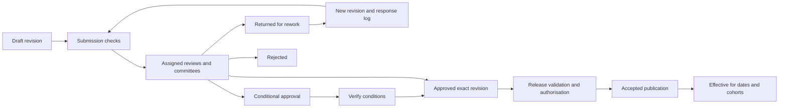

# Curriculum management: requirements for an optional Revelation SRS module

Status: **Proposed requirements baseline — not a statement of delivered functionality**.
Version: 0.1. Date: 11 November 2026.
Proposed product owner: Academic Registry / Academic Quality, with curriculum owners,
student representatives, integration and platform owners participating in review.

## 1. Purpose and scope

Provide a complete curriculum lifecycle within Revelation: design programmes and modules,
map learning outcomes and assessments, define legitimate routes to awards, obtain approval,
return proposals for rework, publish approved versions and maintain them through review,
modification and closure. Institutions may instead use a third-party curriculum-management
application without losing the SRS's operational catalogue, student history or rule evaluation.

The internal capability is a **replaceable module in the modular monolith**, sharing
Revelation's deployment, identity, release cycle and platform services. It is not a new
mandatory microservice. Its authoring and governance data have explicit ownership and
interfaces. Core registration, assessment, progression and reporting consume approved
curriculum through the same contract whichever provider authored it.

These requirements extend [CAT-001–CAT-009](functional-requirements.md),
[BP-03-001](../business-processes/03-curriculum-and-module-registration/bp-03-001-import-and-publish-curriculum-data.md)
and [BP-03-002](../business-processes/03-curriculum-and-module-registration/bp-03-002-assign-programme-route-and-rules.md).
Academic proposal/approval is a new scope: BP-03-001 currently starts after that approval.

**Included:** undergraduate and taught postgraduate programmes; taught elements of PGR;
joint/combined routes; foundation, integrated master's, placement and study-abroad variants;
part-time and flexible study; short courses, credit-bearing microcredentials and configured
apprenticeship/partner provision. Provision types use appropriate templates rather than
forcing every field or rule onto every course.

**Boundaries:** student admissions decisions, actual enrolment and module allocation,
marking, progression/award ratification, finance transactions, room scheduling, VLE content
and individual research supervision remain in their existing systems/modules. Curriculum
management supplies approved definitions, constraints and references to them. Specifying
an assessment is different from recording a student's mark; defining an award is different
from conferring it. Timetable and resource feasibility require evidence from their owning
systems and cannot be inferred from a valid diet alone.

### Terminology

| Term | Meaning in these requirements |
|---|---|
| Programme / course | A coherent course of study leading to an award or defined educational outcome. Institutions may use a different display term. |
| Module | A reusable unit of study, normally with learning outcomes, assessment and credit. Where an institution calls this a “course”, the interface may do so without conflating entity types. |
| Route | A pathway, specialism or named variant within a programme. |
| Diet | The executable rules describing permitted combinations and sequences of modules for a programme/route/cohort and target award; not just a list of recommended modules. |
| Offering | A scheduled delivery of a module/programme version for a period, site, mode and/or partner. It is distinct from its academic definition. |
| Proposal | A governed change request containing draft revisions, rationale, evidence and workflow history. |
| Release | An immutable manifest of approved, mutually compatible curriculum versions prepared for publication. |
| Publication | Delivery and acceptance of a release by the SRS or another destination. |
| Effective | Applicable for the stated dates and cohort. An approved or published version may still be future-dated. |
| Teach-out | Managed continuation for existing students after recruitment or delivery is being closed. |

Priority: **M** = required for the complete baseline; **S** = important planned extension;
**C** = optional. An M is not a claim that the first implementation increment delivers it.
“Shall” describes required behaviour; examples are illustrative institutional policies,
not universal UK regulations. Every requirement ID is stable and suitable for backlog/test linkage.

## 2. Evidence and existing foundations

Commercial benchmarks establish the breadth expected of a curriculum product. These
are public product descriptions, not independently verified demonstrations or a promise
of feature parity. Requirements below are original Revelation design proposals.

| Reference | Relevant benchmark / guidance | Requirement areas informed |
|---|---|---|
| B1 — [CourseLoop Governance](https://courseloop.com/curriculum-governance/) | Proposal routing, collaboration, task visibility and committee records. | AUTH, WF, QUAL |
| B2 — [CourseLoop Mapper](https://courseloop.com/curriculum-mapper/) | Relationships between outcomes, assessments and standards; change impact. | OUT, ASMT |
| B3 — [Kuali Curriculum Management](https://www.kuali.co/solutions/operations/academic-operations/curriculum-management) | Configurable proposal forms, governance routes, dependency visibility and catalogue alignment. | AUTH, WF, PUB |
| B4 — [CourseLeaf CIM public overview, hosted by Ellucian](https://www.ellucian.com/assets/en/partner/courseleaf-confidence-your-curriculum.pdf) | Historical/future curriculum, learning-outcome mapping and SIS/catalogue integration. This older brochure is a capability reference, not a current product certification. | VER, OUT, INT |
| S1 — [QAA Quality Code 2024, Principle 7](https://www.qaa.ac.uk/the-quality-code/2024) | Programme/module design, approval and modification; definitive documentation and reference to qualification frameworks. | PRG, MOD, WF, QUAL |
| S2 — [QAA Qualifications Frameworks](https://www.qaa.ac.uk/the-quality-code/qualifications-frameworks) | Distinct frameworks for England/Wales/Northern Ireland and Scotland. | DAT, DIET |
| S3 — [Higher Education Credit Framework for England](https://www.qaa.ac.uk/the-quality-code/higher-education-credit-framework-for-england) | Reference for configurable credit policies, not a rule to impose on all UK provision. | DAT, DIET, ASMT |
| S4 — [W3C WCAG 2.2](https://www.w3.org/TR/WCAG22/) | Accessibility target for authoring, review, diagrams and published information. | UX, NFR |

References checked 11 November 2026. Maintain editions, applicability and review dates
for national, professional and institutional policies. QAA guidance and vendor descriptions
do not by themselves establish legal compliance or institutional academic approval.

The current code provides useful foundations:

- [Catalogue schema](../../packages/db/src/schema/catalogue.ts): programmes, routes,
  rule sets, modules, relationships, assessment patterns and learning outcomes.
- [Module-selection schema](../../packages/db/src/schema/module-selection.ts): diet
  groups/members and enrolment curriculum bindings; existing validation and selection
  proposals should be extended rather than replaced with a separate rule engine.
- [Module selection rules](../architecture/module-selection-rules.md): records known
  gaps, including timetable checks, joint-honours balance and repeat-module handling.
  Some historical narrative in that document predates its implementation-status section.
- [Integration contracts](../architecture/integration-contract-catalogue.md): existing
  `curriculum-catalogue-sync.v1` and `curriculum-performance-metrics.v1` provide the
  starting exchange vocabulary, not a complete approved-release contract.
- [ADR-024](../decisions/ADR-024-live-temporal-execution.md): live Temporal execution
  exists for selected single-review processes behind flags. Multi-stage curriculum
  governance, parallel review and rework require an explicit extension; they are not
  delivered by enabling the existing generic review builder.

No claim is made here that these foundations already satisfy the requirements below.

## 3. Operating modes, ownership and replaceability

| Mode | Curriculum authoring and approval | Core SRS behaviour |
|---|---|---|
| Internal | Revelation curriculum module is authoritative for its assigned scope. | Accept approved releases through the core publication service. |
| External | Registered third-party provider is authoritative; internal writes/workflow starts are disabled for that scope. | Import, validate, reconcile and preserve approved versions using the same publication rules. |
| Frozen / transition | No new releases accepted for the affected scope while a cutover or controlled pause is in progress. | Continue permitted operations against already accepted versions; retain audit and historical access. |

Operational availability of registration/results must not depend on the internal module
being enabled or the external provider being reachable. A provider switch changes future
authoring authority; it must not rewrite historical provenance.

| ID | P | Requirement |
|---|---|---|
| CM-ARCH-001 | M | The module shall be enableable per tenant and environment without a core code fork, using the module/integration registry and feature controls. Backend checks shall enforce the setting, not just hide navigation. |
| CM-ARCH-002 | M | The core shall retain the operational catalogue, published rule evaluation, student bindings and historical reads when internal authoring is disabled or unavailable. Runtime student operations shall not call the authoring provider synchronously. |
| CM-ARCH-003 | M | An authority registry shall identify one permitted writer for each curriculum object/scope and effective interval. Conflicting internal/external writes shall be rejected or quarantined with an actionable explanation. |
| CM-ARCH-004 | M | Internal and external releases shall use the same versioned canonical contract, validation and acceptance semantics. An internal service call may share the deployment/transaction boundary but shall not bypass controls. |
| CM-ARCH-005 | M | Curriculum-owned draft, proposal and workflow repositories shall be accessed through public module interfaces. Core modules shall depend on published contracts and catalogue interfaces, never on draft tables or vendor payloads. |
| CM-ARCH-006 | M | External adapters shall use authenticated integration APIs/events/files; third parties shall not receive direct database-write access. Vendor-specific mapping shall remain outside the core domain model. |
| CM-ARCH-007 | M | Disabling authoring shall preserve archived drafts, approved versions, evidence, decisions and access appropriate to retention policy. It shall not uninstall/delete historical records or silently cancel open proposals. |
| CM-ARCH-008 | M | Provider activation shall require verified contract/rule capabilities, source-ID mappings, authority scope and reconciliation results. Unsupported mandatory semantics shall prevent activation/publication rather than be silently dropped. |
| CM-ARCH-009 | S | Institutions shall be able to use different providers for explicitly partitioned portfolios. Shared modules shall retain a single owner, with read/use rights and dependency references across portfolios; no overlapping authority is permitted. |
| CM-ARCH-010 | M | Core-only deployment tests shall pass with the authoring module disabled and with an external provider offline, covering registration, assessment, progression and historical reconstruction. |
| CM-ARCH-011 | M | Every operational catalogue-write path, including existing admin/API bulk endpoints, shall enforce publication authority and approved-version controls. Emergency correction shall require a governed correction release; direct edits shall not bypass the selected provider's authority or approval. |

### Data ownership

| Information | Authoritative owner | Consumer boundary |
|---|---|---|
| Draft definitions, comments, consultations, committees and proposal decisions | Selected curriculum provider | Internal module/API or external provenance package; drafts never become operational by ordinary save. |
| Approved academic specifications, diets and their release manifest | Selected curriculum provider for authoring authority | Core accepts immutable versions with provenance and validation evidence. |
| Accepted operational versions and the version actually used for a student | Core SRS | Existing catalogue/rules interfaces; preserved after provider replacement. |
| Student choices, prior achievement, exceptions, marks, progression and conferred awards | Relevant core domain services | Curriculum receives authorised aggregate evidence; cannot mutate student outcomes. |
| Capacity, scheduled teaching and room/timetable data | Configured operational owner | Referenced as delivery evidence, not overwritten by academic approval. |
| Fees, admissions criteria execution, staffing and partner agreements | Their owning domains/systems | Curriculum stores approved references/snapshots where needed, with explicit provenance. |

## 4. Definitions and academic structure

### 4.1 Common data requirements

| ID | P | Requirement |
|---|---|---|
| CM-DAT-001 | M | Every academic entity shall have a tenant-scoped stable identity, separately versioned content, human-readable codes and source aliases. A title/code change shall not create a different identity accidentally. |
| CM-DAT-002 | M | Qualification framework, level framework, credit unit and credit value shall be explicit and separately represented. Scottish levels shall not be forced into an FHEQ-only field or treated as equal merely because numeric values coincide. |
| CM-DAT-003 | M | Credit precision, conversion and workload policies shall be configurable with provenance. Fractional credits and non-credit provision shall be supported; no implicit CATS/ECTS or hours conversion shall be applied. |
| CM-DAT-004 | M | The model shall distinguish programme, route, target/exit award, stage, module, component and offering, with typed relationships and valid dates. Owning, teaching and awarding organisations shall be separate. |
| CM-DAT-005 | M | Effective applicability shall support cohort/entry year, period, route, site, delivery mode, partner and jurisdiction as required. Ambiguous or overlapping applicable versions shall be detected before publication. |
| CM-DAT-006 | M | Reference values, custom fields and mandatory-field rules shall be tenant-configurable, versioned and exportable. Historical records shall retain the definitions needed to interpret values retired later. |
| CM-DAT-007 | M | Localised names/descriptions and configurable institutional terminology shall be supported while retaining stable semantic entity types and codes in APIs. Required translations shall have review status. |
| CM-DAT-008 | M | All published cross-references shall resolve to explicit compatible versions or a documented, reproducible resolution rule captured in the release. A future edit shall not alter an old release's dependencies. |

### 4.2 Programme and course definitions

Programme specifications shall support the following structured fields; template policy
determines which are required for a particular provision type. Attachments supplement,
but do not substitute for, machine-readable structures and rules.

| Field group | Required capability |
|---|---|
| Identity and authority | Code, short/full/award titles, description, owning school, academic lead, approving body, awarding body and teaching partners. |
| Qualification and route | Framework/level, target and alternative exit awards, route/specialism, subject classifications, credit totals and jurisdiction. |
| Duration and delivery | Stages, full-/part-time patterns, minimum/normal/maximum duration, entry points, campus, online/blended/placement modes and language. |
| Educational design | Aims, rationale, programme learning outcomes, teaching strategy, employability/graduate attributes, research links and subject/PSRB references. |
| Entry and progression | Admissions/recognition-of-prior-learning policy references, approved diet, progression gates, transfer routes and award/classification rule references. |
| Assessment | Programme assessment strategy, dissertation/project/placement requirements, outcome coverage and reassessment/compensation policy references. |
| Quality and lifecycle | Approval reference, conditions, effective/cohort dates, next review, accreditation period, recruitment status and teach-out plan. |
| Delivery evidence | Staffing, library/lab/digital resources, viability/costing references, capacity assumptions, accessibility and partner readiness. |
| Publication | Definitive specification, student-facing description, marketing variant, contacts and destination-specific publication status. |

| ID | P | Requirement |
|---|---|---|
| CM-PRG-001 | M | Authors shall create, copy and revise programme specifications using provision-specific templates covering the field groups above, with field-level completeness checks before submission. |
| CM-PRG-002 | M | Programmes shall support multiple named routes, majors/minors or joint combinations, and explicit shared versus route-specific content without duplicating shared module identities. |
| CM-PRG-003 | M | Each target, intermediate and exit award shall reference its own versioned credit, level, compulsory-achievement and classification/eligibility requirements. An exit award shall not be inferred solely from a lower credit total. |
| CM-PRG-004 | M | Full-time, part-time, accelerated, interrupted-return, placement and study-abroad structures shall express alternative stage/period sequences and completion limits without equating study stage with calendar year. |
| CM-PRG-005 | M | Entry, advanced standing, articulation and RPL policies shall specify permitted entry stages, evidence/authority references and limits; student-level acceptance remains in the appropriate SRS process. |
| CM-PRG-006 | M | Joint, validated, franchised and collaborative provision shall record distinct awarding, delivery and approval responsibilities, agreement versions and required partner sign-offs. |
| CM-PRG-007 | M | Professional/accreditation requirements shall have body, scope, status, valid dates, evidence and affected routes/cohorts. Expiry or conditional status shall produce explicit approval/publication warnings or blocks according to policy. |
| CM-PRG-008 | M | Programme approval shall include recorded resource/delivery checks and unresolved dependencies, with accountable reviewers and evidence dates; academic approval alone shall not imply capacity or timetable availability. |
| CM-PRG-009 | M | Suspension of recruitment, suspension of delivery, closure and teach-out shall be distinct actions with effective dates, student impact and approved continuation/transfer arrangements. |
| CM-PRG-010 | S | Short awards, stackable microcredentials and apprenticeship variants shall support reusable units, stacking/credit-reuse constraints and external standard/assessment references without inventing credit for non-credit activity. |

### 4.3 Module definitions

| Field group | Required capability |
|---|---|
| Identity | Stable ID/code, titles, owning/teaching organisations, lead, subject area, language and source references. |
| Academic specification | Description, aims, syllabus/topics, outcomes, qualification/credit framework, level, credits and notional workload. |
| Learning and teaching | Contact/scheduled hours, practical/placement time, independent study, delivery methods, learning activities and resource/accessibility requirements. |
| Assessment | Components, method, weighting, size/duration, submission/assessment pattern, pass/hurdle rules, reassessment and outcome mappings. |
| Relationships | Prerequisites, co-requisites, exclusions, equivalents, replacements, shared/cross-listed instances and programme usages. |
| Delivery and lifecycle | Period/site/mode variants, offering prerequisites, approval/effective dates, next review, availability status and withdrawal/teach-out implications. |

| ID | P | Requirement |
|---|---|---|
| CM-MOD-001 | M | Authors shall manage structured module specifications using the field groups above, with different validation for credit-bearing, non-credit, project, placement and other configured module types. |
| CM-MOD-002 | M | Shared modules shall retain one governed definition and expose every using programme/route/cohort in a where-used view; proposed changes shall notify affected owners. |
| CM-MOD-003 | M | A module version shall be distinct from its period-specific offerings. Site/mode variations shall declare whether they are approved academic variants or operational delivery details. |
| CM-MOD-004 | M | Prerequisite and co-requisite expressions shall support combinations, minimum achievement and timing; exclusions, equivalence and replacement shall have separate semantics and date ranges. |
| CM-MOD-005 | M | Cross-listed/shared teaching shall preserve academic identities and define credit equivalence explicitly, preventing duplicate credit where a student takes equivalent versions under different codes. |
| CM-MOD-006 | M | Teaching/contact, independent-study and placement workload shall be recorded in explicit units and checked against the applicable credit/workload policy, with explained exceptions rather than assumed conversions. |
| CM-MOD-007 | M | The system shall record module resource and accessibility requirements, including essential placement/practical conditions, and route unresolved delivery requirements to the designated reviewer. |
| CM-MOD-008 | M | Module retirement or replacement shall identify dependent diets, prerequisites, offerings and affected cohorts before approval; no release may leave mandatory dependencies dangling. |
| CM-MOD-009 | M | Reading/resource lists shall support references to the institution's library service, ownership and review dates; updating a resource list shall follow its configured materiality rules. |
| CM-MOD-010 | S | Reusable syllabus/topic and teaching-activity components shall be versionable, with explicit inheritance/override behaviour and impact reporting when a shared component changes. |

### 4.4 Outcomes, mapping and assessment design

| ID | P | Requirement |
|---|---|---|
| CM-OUT-001 | M | Learning outcomes shall be individually identified/versioned statements with level, type, ownership and applicability; they shall not exist only as unstructured prose embedded in a document. |
| CM-OUT-002 | M | Authors shall map programme/route outcomes to modules, module outcomes to assessment components, and outcomes to graduate attributes, subject benchmarks and professional standards, using versioned many-to-many links. |
| CM-OUT-003 | M | Mappings shall distinguish taught, practised and assessed coverage, with optional progression levels, rationale and evidence; a mapping shall not be presented as proof of achieved student competence. |
| CM-OUT-004 | M | Reviewers shall see accessible outcome matrices and identify unmapped mandatory outcomes, assessments with no mapped outcome and dependency changes that invalidate an existing map. |
| CM-OUT-005 | M | Coverage validation shall account for optional pathways: if an allowed diet can omit a mandatory programme outcome's assessed coverage, it shall report that path and block publication until the design or approved coverage evidence is corrected. |
| CM-OUT-006 | M | Changes to a linked outcome/standard shall produce an impact list and require review of affected mappings; mappings shall never silently point to replacement text. |
| CM-OUT-007 | S | Authors shall compare assessment density and outcome coverage across stages and routes, with configurable alerts for gaps, duplication and overload; the system shall label these indicators as design evidence, not academic judgement. |
| CM-ASMT-001 | M | Assessment components shall specify method, formative/summative role, weighting, mark scale, workload/size, individual/group basis, timing pattern and relevant module outcomes. |
| CM-ASMT-002 | M | Validation shall check weights, allowed scales, mandatory/hurdle components and pass conditions against the pinned assessment policy, reporting precise errors; it shall not assume every scheme is a simple weighted average. |
| CM-ASMT-003 | M | Original and reassessment patterns shall be separately defined and linked, including changed methods, caps, attempts and permitted component carry-forward. |
| CM-ASMT-004 | M | Assessment and award definitions shall reference versioned compensation, condonement, non-condonable components/modules, classification and rounding rules maintained through the shared rules framework. |
| CM-ASMT-005 | M | Changes shall show impacts on existing assessment components, offerings and student attempts; curriculum approval shall not rewrite issued marks, ratified results or assessment arrangements already bound to a cohort. |
| CM-ASMT-006 | M | Assessment specifications shall record accessibility review and permitted equivalent assessment approaches; individual reasonable adjustments remain under the existing support/assessment authority. |
| CM-ASMT-007 | S | Programme-level assessment calendars shall expose planned bunching/workload using relative teaching periods and warn when actual dates are unavailable; the feature shall not claim to replace examination scheduling. |
| CM-ASMT-008 | M | Published assessment structures shall be consumable by core assessment services without manual transcription and shall retain source/version and approval references. |

## 5. Course diets, rules and award pathways

A diet must answer three different questions: **can this curriculum provide a coherent
path to its award; may this student select this combination now; and do achieved results
satisfy the award rules?** The module designs and tests the first and supplies the same
versioned rules used by the SRS for the others. It does not confer awards.

| ID | P | Requirement |
|---|---|---|
| CM-DIET-001 | M | A diet shall be scoped to programme, route, target award, cohort and applicable delivery pattern, with explicit policy precedence and an error if more than one equally applicable rule set exists. |
| CM-DIET-002 | M | Authors shall define compulsory sets, optional pools, electives and nested AND/OR groups with minimum/maximum module counts and credits, including exact choose-N and choose-X-credits combinations. |
| CM-DIET-003 | M | Constraints shall cover total credits, stage/period load, credits by framework level and subject, permitted adjacent-level study and joint-honours/major-minor balance. |
| CM-DIET-004 | M | Diets shall express sequence, prerequisites, co-requisites, exclusions, alternative prerequisites and threshold achievement. Validation shall distinguish prerequisite cycles from deliberately simultaneous co-requisite groups. |
| CM-DIET-005 | M | Pool membership and dynamic subject-based selectors shall resolve to a pinned versioned set for each release; adding a future module shall not silently change an existing cohort's choices. |
| CM-DIET-006 | M | Credit allocation shall prevent duplicate counting across overlapping pools, cross-listings, equivalent modules and repeated attempts, unless an explicit authorised rule permits a particular reuse. Explanations shall show where each credit was allocated. |
| CM-DIET-007 | M | Diets shall identify compulsory/non-condonable modules, dissertations, placements and professional hurdles; reaching a credit total alone shall not satisfy these obligations. |
| CM-DIET-008 | M | RPL/transfer-credit rules shall specify maxima, levels, exemptions, recency and residency/locally-earned requirements. Student-specific decisions shall be referenced, not fabricated by the diet engine. |
| CM-DIET-009 | M | Part-time patterns, repeats, interruption/return, transfers, placement/study-abroad and alternative entry points shall have explicit routes or transition rules; chronology and maximum study duration shall be evaluated. |
| CM-DIET-010 | M | Target and exit awards shall have separate eligibility paths with credit, level, mandatory outcome/hurdle and policy conditions; passing a selection check shall never imply award eligibility. |
| CM-DIET-011 | M | Design validation shall detect contradictory bounds, missing/retired dependencies, unreachable required modules and impossible award paths; it shall produce a valid witness pathway or an explained failure for the supported rule language. |
| CM-DIET-012 | M | Validation results shall distinguish valid, invalid and not fully evaluated. Resource limits, missing timetable/capacity data or unsupported semantics shall not be reported as a pass; unresolved required checks shall prevent publication. |
| CM-DIET-013 | M | A what-if facility shall test synthetic student histories and planned/achieved modules against an explicitly selected curriculum version, with rule-level explanations and no writes to real registrations/results. |
| CM-DIET-014 | M | The authoring validator and operational selection/progression/award services shall share a typed, versioned rule model and conformance tests. Rule semantics shall not be independently reimplemented in the browser or a provider adapter. |
| CM-DIET-015 | M | Diets shall be represented by an inspectable rule tree and editable forms, with an accessible structural view. Staff shall configure supported rules without SQL, arbitrary code or unrestricted expressions. |
| CM-DIET-016 | M | Authorised student exceptions shall reference the exact rule/version, subject, scope, authority and rationale; an individual exception shall not mutate the approved diet for other students. Non-waivable constraints shall remain enforced. |
| CM-DIET-017 | M | Academic permissibility and operational availability shall be reported separately. A valid diet shall not promise a seat, a timetable without clashes or an offering that has not been confirmed. |
| CM-DIET-018 | S | Authors shall compare pathways for credit load, option breadth and completion bottlenecks, including the effect of removing an offering; suggestions shall preserve constraints and require human acceptance. |

### Worked acceptance fixture: a fictional 360-credit programme

This is a test institution's policy, not a national default. Each stage requires 120
credits, all modules carry 20 credits unless stated, and all required modules must be
passed. Illustrative levels 4, 5 and 6 belong to the fixture's named level framework.

| Stage | Compulsory | Choice | Credit check |
|---|---|---|---|
| 1, level 4 | C4A, C4B, C4C | Three of O4A, O4B, O4C, O4D | 60 + 60 = 120 |
| 2, level 5 | C5A, C5B, C5C | Three of O5A, O5B, O5C, O5D | 60 + 60 = 120 |
| 3, level 6 | Dissertation D6 (40), C6 (20) | Three of O6A, O6B, O6C, O6D | 60 + 60 = 120 |

Additional fixture rules: O5A requires a pass in O4A; O5B and O5D are mutually exclusive;
D6 is non-condonable. The configured exit diploma requires 240 passed credits including
120 at level 5 and its own compulsory modules. Classification is governed by a separate
versioned rule set. No passed credit may count twice.

Expected examples:

- Selecting O4A/O4B/O4C, then O5A/O5B/O5C, then O6A/O6B/O6C alongside the compulsory
  modules gives a structurally valid 360-credit plan; actual award eligibility remains
  dependent on achievement and the configured award rules.
- Choosing O5A without O4A fails the prerequisite; choosing O5B and O5D fails exclusion.
- A 360-credit result with D6 failed does not earn the target award. An eligible exit
  award must be evaluated against its own requirements.
- A module exposed in two pools contributes its credit only once, unless a separately
  specified reuse rule applies; the displayed allocation identifies the consumed pool.
- A variant making O5A compulsory while removing every permissible way to meet its O4A
  prerequisite is rejected as structurally impossible, even if its credit totals add up.
- A path that meets credit rules but bypasses all assessments of a mandatory programme
  outcome fails outcome-coverage validation.

## 6. Authoring, collaboration and approval

### Roles and responsibility

| Role | Typical authority, restricted to assigned organisational/proposal scope |
|---|---|
| Curriculum author / module or programme lead | Draft and revise; respond to review; submit. |
| Co-author / contributor | Edit assigned sections; cannot gain approval authority through edit rights. |
| Quality officer / curriculum manager | Validate completeness, administer routes and advise on policy. |
| Academic reviewer / committee member | Comment, request changes and decide within delegated authority. |
| Committee chair / secretary | Manage agendas, attendance, quorum, decisions and approved minutes. |
| External/PSRB/partner reviewer | Review explicitly shared material with time-limited access. |
| Student representative | Contribute to designated consultations without unrestricted access to confidential material. |
| Publisher / Registry officer | Release approved specifications to operational systems within delegated authority. |
| Auditor | Read authorised historical evidence and exports without changing decisions. |
| Tenant administrator / integration operator | Configure permitted templates/provider connections; not automatically entitled to academic sign-off. |

Institutions configure their role names and authority matrices. Separation of author,
approver and publisher is a policy control that must be expressible and testable.

### Proposal lifecycle

Withdrawn/cancelled proposals retain their history. Review, publication and effective
status are separate dimensions, not one overloaded status field. Future-dated versions
may be published before they are effective. A release may contain dependent programme,
module, diet, outcome and assessment revisions.

| ID | P | Requirement |
|---|---|---|
| CM-AUTH-001 | M | The interface shall support new provision, clone, amendment, annual rollover, periodic revalidation, suspension, closure and teach-out proposals, recording rationale, scope, planned implementation and change classification. |
| CM-AUTH-002 | M | Configurable forms shall support provision/role/stage-specific fields, required evidence, conditional sections and validation. Form definitions shall be versioned and pinned to submissions. |
| CM-AUTH-003 | M | Authors shall save drafts, resume work, preview the specification and submit only after blocking checks pass; incomplete drafts shall never alter the operational catalogue. |
| CM-AUTH-004 | M | Co-authors shall have explicit section/object permissions. Concurrent edits shall use revision checking and show conflicts rather than silently overwriting another author's work. |
| CM-AUTH-005 | M | Comments, suggestions and requested changes shall attach to stable fields/sections and revisions, with author, date, visibility, resolution status and an attributable response. |
| CM-AUTH-006 | M | Authors/reviewers shall compare revisions using field-level and structural differences, including removed modules, rule changes, mappings, assessment weights and affected cohorts. |
| CM-AUTH-007 | M | Related changes shall be bundled into a proposal/release with explicit dependencies and owners; the system shall detect missing approvals or incompatible dependent versions. |
| CM-AUTH-008 | M | Import/copy/bulk-edit tools shall provide validation previews, provenance and per-item errors. Bulk operations shall not bypass proposal approval or convert unapproved imports into live curriculum. |
| CM-AUTH-009 | S | Annual rollover shall copy selected structures to a new draft and report stale policies, resources, dates and dependencies for review; it shall not copy prior approvals as fresh approval. |
| CM-WF-001 | M | Authorised administrators shall configure versioned approval routes with sequential/parallel steps, conditional branches, reviewers, committees and publication gates through validated forms; unsupported routes shall be rejected before activation. |
| CM-WF-002 | M | Routing shall depend on explicit criteria such as proposal type, materiality, owning school, qualification, credit/assessment change, partner and PSRB implications. A route preview shall explain why each step is required. |
| CM-WF-003 | M | Each submission shall pin its workflow/template version, exact content revision and dependency manifest. A decision shall identify what was reviewed, by whom, in which role and under which authority. |
| CM-WF-004 | M | Decisions shall include approve, reject, return for rework, defer and conditional approval where policy allows, with required rationale. Returning shall identify requested changes and the responsible author, not close the proposal as rejected. |
| CM-WF-005 | M | Resubmission after rework shall create a new revision and review cycle retaining previous comments, responses, evidence and decisions. Reviewers shall see the changes since the revision they last assessed. |
| CM-WF-006 | M | A change after review shall invalidate affected approvals according to an explicit materiality/impact policy. Prior approval remains historical evidence; it shall not be silently transferred to changed academic content. Administrative-only exceptions require recorded authority and justification. |
| CM-WF-007 | M | Conditional approval shall record each condition, owner, deadline, evidence and independent verification where required. Blocking conditions shall prevent final publication until discharged; authorised deferral of a non-blocking condition remains visible. |
| CM-WF-008 | M | Parallel reviews shall use configured all-required/quorum/veto rules and deterministic joins. A returned/rejected branch shall prevent an apparent successful join; late decisions from obsolete revisions shall be rejected. |
| CM-WF-009 | M | Committee decisions shall record meeting/date, attendees, quorum, conflicts/recusals, vote or delegated decision, minutes/evidence and authority. A secretary recording a collective decision shall be distinguishable from personally approving it. |
| CM-WF-010 | M | Delegation, absence cover and reassignment shall be time-limited, scope-limited and audited. No-author-self-approval and separation-of-duties controls shall be enforceable; unresolved conflicts shall route to another authorised reviewer. |
| CM-WF-011 | M | Tasks shall have clear ownership, status, due date, notifications and escalation. Reminders/escalations shall never imply approval. Working-day calendars and pauses shall be explicit policy; elapsed-day deadlines shall be labelled accurately. |
| CM-WF-012 | M | Curriculum workflows shall use the shared durable execution facilities under ADR-024, extended for these routes. Restarts/retries shall not duplicate decisions, reviews, notifications or publications; execution failures shall not be recorded as academic rejection. |
| CM-WF-013 | M | Cancellation, withdrawal and reopening shall require authority and reason, preserve the prior workflow, and prevent stale tasks from deciding a new revision. An approved/effective curriculum change requires a new proposal rather than deleting the old approval. |
| CM-WF-014 | M | External, student, employer and service consultations shall have scoped invitations, deadlines and attributable responses; required consultations shall be checked before sign-off, including recorded non-response where policy permits. |
| CM-WF-015 | M | Import of an external approved release shall verify the trusted source's approval/provenance evidence against the authority contract; it shall not unnecessarily rerun Revelation's internal academic approval route. Missing required evidence shall quarantine publication. |
| CM-WF-016 | S | Committee agenda packs, outstanding-action lists and notifications shall be generated from the exact submitted revisions, with confidential material restricted and revised packs visibly identified. |

## 7. Version control, audit and student protection

| ID | P | Requirement |
|---|---|---|
| CM-VER-001 | M | Stable object identity, draft revision, academic approved version, publication release and workflow-definition version shall be separately identifiable and linked. Approval shall freeze the exact version and its dependency manifest. |
| CM-VER-002 | M | Approved/effective records shall preserve valid time and recorded time. Users shall be able to reconstruct both “what applied to this cohort on this date” and “what the institution knew on that date”. |
| CM-VER-003 | M | Multiple current/future cohort versions shall coexist without overwriting each other. Effective-period and applicability checks shall reject ambiguous overlapping versions within the same authority scope. |
| CM-VER-004 | M | Draft branching, copying and merging shall retain lineage and require explicit resolution of conflicting edits. Merging shall not import an approval that was given to different content. |
| CM-VER-005 | M | Audit shall capture actor/service, role/delegation, tenant, timestamp, action, reason, before/after revision or diff, workflow decision and correlation IDs for creation, edits, approvals, publication, access grants and authority changes. |
| CM-VER-006 | M | Decision/audit evidence shall be append-only to ordinary users, with tamper-evident hashes/manifests and retention controls. A correction shall append a linked record rather than rewrite an earlier decision. |
| CM-VER-007 | M | Publication shall produce an immutable specification/evidence bundle that identifies content, dependency versions, approval history, conditions and release hash. Authorised users shall retrieve historical bundles without a live provider connection. |
| CM-VER-008 | M | Existing enrolment, registration, assessment and award bindings shall remain attached to the curriculum/rules actually used. Changing provider or publishing a new version shall not silently rebind existing students. |
| CM-VER-009 | M | Cohort transitions and retrospective corrections shall require impact analysis, authority, reasons, communications/consent evidence where institutional policy requires, and explicit student/route scope. Ratified outcomes shall use existing correction controls. |
| CM-VER-010 | M | Rollback of published content shall be a new authorised corrective release with retained history and downstream reconciliation; it shall not erase an already consumed release. |
| CM-VER-011 | M | Search/export shall support as-at/as-known dates and version comparison, retaining source/approval provenance even when the original external system has been decommissioned. |

## 8. Publication and operational handover

| ID | P | Requirement |
|---|---|---|
| CM-PUB-001 | M | A release shall declare all included objects, dependency versions, applicability, approval evidence, publisher authority and content hash. The system shall validate the complete dependency closure before accepting it. |
| CM-PUB-002 | M | Approval, release authorisation, destination acceptance and effective availability shall be distinct states. Publication shall be blocked by unresolved mandatory conditions, invalid rules, missing mappings or ambiguous authority. |
| CM-PUB-003 | M | Core acceptance shall apply a declared atomic release unit transactionally: either all required structures become available or the previously accepted catalogue remains unchanged. Partial acceptance shall require explicit independent units and separate receipts. |
| CM-PUB-004 | M | Scheduled/future publication shall honour embargo, effective dates and cohort restrictions. Future data may be previewed with permission but shall not become selectable for an ineligible current cohort. |
| CM-PUB-005 | M | Staff/student specifications and destination feeds shall derive from the accepted version. Internal comments, personal reviewer information and confidential business cases shall be excluded from public outputs. |
| CM-PUB-006 | M | Publication to the SRS, website/catalogue, admissions/marketing, VLE and other subscribed systems shall have per-destination status, acknowledgement, retry and reconciliation records. Failure at one destination shall not masquerade as success or silently undo another accepted publication. |
| CM-PUB-007 | M | Retirement, suspension, replacement and teach-out shall be explicit events with dates and affected dependencies. Absence from an imported snapshot shall not mean deletion unless the agreed contract explicitly declares that meaning. |
| CM-PUB-008 | M | Marketing text shall be linked to its academic version and reviewed for consistency; provisional/promotional descriptions shall not be published as definitive approved specifications. |
| CM-PUB-009 | M | A preview/dry-run shall show changes, validations, impacted consumers/cohorts and planned effective dates without committing. Commit shall reject a stale preview whose inputs or authority have changed. |

## 9. Review, impact analysis and quality management

| ID | P | Requirement |
|---|---|---|
| CM-QUAL-001 | M | Programmes/modules shall have scheduled annual monitoring and periodic review/revalidation, with owners, due dates, evidence, actions and expiry/escalation policy. |
| CM-QUAL-002 | M | Change impact shall traverse all using routes, diets, outcomes, assessments, accreditation obligations, offerings and student cohorts; a shared-module change shall not be reviewed only by its authoring department. |
| CM-QUAL-003 | M | Authorised aggregate enrolment, demand, progression, completion, performance and feedback evidence shall be linked to the reporting period, cohort, curriculum version and calculation definition. Small-cohort suppression shall protect individuals. |
| CM-QUAL-004 | M | Reviewers shall record conclusions, required actions, accountable owners and evidence of closure; completion of a review task alone shall not imply those actions were implemented. |
| CM-QUAL-005 | M | Standards/PSRB libraries shall carry source, edition, jurisdiction, applicability and review dates; mapping shall support evidence packs without asserting automatic accreditation or legal compliance. |
| CM-QUAL-006 | M | Dashboards shall show proposals by stage, overdue reviews, rework cycles, outstanding conditions, publication failures and upcoming accreditation/teach-out deadlines, filtered by user scope. |
| CM-QUAL-007 | S | Portfolio analysis shall identify low-demand/duplicate provision and resource bottlenecks using defined measures; recommendations shall be explainable and shall not automatically close or amend provision. |
| CM-QUAL-008 | C | Where enabled, AI assistance shall operate only under an approved institutional policy, with provenance and human review of drafted descriptions, mapping suggestions or summaries; it shall have no authority to approve, publish or change rules autonomously. |

## 10. Integration contracts and switching providers

Build on `F-CM-SIS-01` / `curriculum-catalogue-sync.v1` and `F-SIS-CM-01` /
`curriculum-performance-metrics.v1`. A compatibility assessment must decide whether a
backwards-compatible extension suffices or an explicit successor version is required.
Do not silently change v1 semantics to mean atomic approval bundles.

### Canonical release envelope

At minimum, the contract shall carry: tenant and authority scope; source/provider and
source-object identifiers; contract/schema and rule-language versions; release ID,
sequence and content hash; proposal/approval references and evidence links; authorisation
and publication timestamps; effective/cohort applicability; object/version manifest;
programme/route/award/module definitions; outcomes/maps; assessment definitions; diets
and policy references; dependencies; explicit changes/closures; and correction/supersession
links. No student-level data is required in the incoming curriculum bundle.

Receipts identify received, validated, rejected/quarantined, accepted and effective states,
including canonical object mappings, precise error paths and retry/reconciliation details.

| ID | P | Requirement |
|---|---|---|
| CM-INT-001 | M | Internal and external providers shall publish the canonical envelope using supported API and/or file contracts; vendor fields shall be mapped with explicit validation and retained provenance. |
| CM-INT-002 | M | Provider capabilities shall declare supported entity fields, rules, approval evidence and lifecycle events. Import shall reject an unsupported mandatory rule or map it through a proven equivalent; opaque free text shall not count as executable validation. |
| CM-INT-003 | M | Transport shall authenticate service identity and constrain tenant, environment and authority scope. Schema/content validation, file size/type checks and safe parsing shall run before any live write. |
| CM-INT-004 | M | Idempotency shall use tenant, provider authority epoch, release identity and content hash. Repeating the same release shall return its receipt without duplicating versions; conflicting content under the same identity shall be rejected. |
| CM-INT-005 | M | Delta and full-snapshot exchange shall support sequence/gap detection, dependency ordering, replay and explicit closure semantics. Out-of-order or incomplete input shall be quarantined with a recoverable reconciliation path. |
| CM-INT-006 | M | Source aliases shall map to stable canonical objects/versions. Replacing a provider shall not create duplicate modules merely because its identifiers differ, and a reused external code shall not merge distinct objects silently. |
| CM-INT-007 | M | A core publication receipt and catalogue events shall commit through a retry-safe transaction/outbox pattern. Consumers shall deduplicate event identities; disconnected destinations shall not lose changes. |
| CM-INT-008 | M | The system shall expose authorised validation/status queries, snapshot/export and reconciliation reports with counts/hashes and per-object differences; operators shall retry corrected input without editing production tables. |
| CM-INT-009 | M | Curriculum feedback exports shall implement period/version/cohort definitions and privacy controls, using existing reporting ownership rather than exposing unrestricted student records to the provider. |
| CM-INT-010 | M | Contract and rule-language evolution shall have explicit compatibility, deprecation and consumer-conformance tests; a rolling deployment shall not reinterpret a previously accepted release. |
| CM-MIG-001 | M | Switching provider shall be a governed, resumable migration with an owner, scope, source/target configuration, inventory, mapping, reconciliation, cutover criteria and rollback plan. A configuration toggle alone shall not execute it. |
| CM-MIG-002 | M | Preflight shall inventory current, future and retired versions; source aliases; active student bindings; open proposals/tasks/conditions; releases in flight; dependencies and historical evidence required after the switch. |
| CM-MIG-003 | M | Before changing authority, publication shall be frozen or sequenced behind an explicit watermark. Drain/quarantine pending messages, reconcile deltas and record the final accepted source sequence; student operations on accepted data continue. |
| CM-MIG-004 | M | Target imports shall support dry-run validation and object/version matching, with no writes until mappings and required equivalence checks pass. Missing historical evidence shall be reported, not reconstructed as fictitious approval. |
| CM-MIG-005 | M | Open proposals shall be explicitly completed in the old provider, cancelled with evidence, or migrated/restarted under a documented policy. Prior signatures shall not be silently converted into approval under a new workflow. |
| CM-MIG-006 | M | Cutover shall atomically change publication authority with a new epoch/token and audit record. Late messages from the old authority shall be rejected/quarantined, including commands carrying credentials that were valid before cutover. |
| CM-MIG-007 | M | Historical SRS identifiers, versions and student bindings shall remain stable across cutover; retained evidence shall identify the original authoring/approving provider rather than the new one. |
| CM-MIG-008 | M | A reversible pre-activation rollback shall restore prior authority after reconciliation. If the new provider has published consumed changes, rollback shall reconcile those changes and issue corrective releases, never blindly restore an old database snapshot. |
| CM-MIG-009 | M | Both internal-to-external and external-to-internal cutovers shall have repeatable tests and a documented export format for definitions, rules, mappings, provenance and evidence references. Unexportable data shall be disclosed in the migration report. |
| CM-MIG-010 | M | Turning the internal module off shall revoke authoring/publication routes, scheduled jobs and new workflow starts for its former scope while keeping authorised archive/history access. Tasks retained for completion shall have an explicit restricted operating mode. |

### Required cutover sequence

1. Inventory and map objects, rules and authority scope; run contract-conformance tests.
2. Import to a staging area, compare counts/hashes/semantics and test representative diets.
3. Resolve open proposals and evidence retention; agree the cutover watermark.
4. Freeze new publication for the scope; drain and reconcile outstanding messages.
5. Activate the new authority epoch and permissions; reject stale-provider writes.
6. Publish/accept a controlled release, verify downstream status and student-history invariance.
7. Monitor reconciliation, retain prior evidence and close the migration with recorded sign-off.

## 11. Security, usability and non-functional requirements

| ID | P | Requirement |
|---|---|---|
| CM-SEC-001 | M | Every read/write/export/job shall enforce tenant isolation and organisational/object scope. Tests shall include guessed IDs, bulk endpoints, background activities and external reviewers. |
| CM-SEC-002 | M | Permissions shall distinguish authoring, commenting, academic approval, condition verification, publication, provider switching, rule/template administration and audit export. A technical administrator shall not implicitly obtain academic decision authority. |
| CM-SEC-003 | M | Reviewer access and delegated powers shall expire/revoke safely, with authenticated decisions, conflict checks and an audit of the authority used; shared accounts shall not provide attributable sign-off. |
| CM-SEC-004 | M | Confidential proposals, commercial cases, review comments and personal contributor details shall have classification-based controls. Public specifications shall be generated from an explicit allowlist. |
| CM-SEC-005 | M | Evidence attachments shall have safe type/size validation, malware scanning where uploaded content is supported, controlled storage and authorised download; external links shall not cause uncontrolled server-side fetching. |
| CM-SEC-006 | M | Retention, erasure exceptions, legal holds and archival access shall be configurable by record class. Published academic history shall be preserved for required student reconstruction while personal data is minimised. |
| CM-SEC-007 | M | Secrets shall use platform secret management. Logs and Temporal payloads shall carry minimal references rather than confidential proposal bodies or credentials, following the existing workflow trust boundary. |
| CM-SEC-008 | M | Audit export/access to restricted evidence and provider-authority changes shall be recorded; unauthorised attempts shall be observable without logging the protected content. |
| CM-UX-001 | M | Staff shall have a searchable curriculum workspace with filters for owner, programme/module, route, cohort, status, pending action, effective date and provider, including clear version/context labels. |
| CM-UX-002 | M | Guided programme/module/diet forms shall support autosave with visible save state, navigation without data loss, validation summaries and links to the field requiring correction. |
| CM-UX-003 | M | Authors/reviewers shall have task lists, progress/history views, revision comparison and a response-to-review workspace, including clear indicators of stale or invalidated approvals. |
| CM-UX-004 | M | Diet builders, outcome matrices, workflow diagrams and diff views shall have keyboard/screen-reader alternatives; drag-and-drop, colour and hover shall not be the sole way to edit or understand them. |
| CM-UX-005 | M | Public/student information shall clearly distinguish provisional, approved, effective, suspended and teach-out provision and identify the applicable intake/version. |
| CM-UX-006 | M | Date/number formats, terminology and content language shall be localisable; bilingual content shall have translation completeness/review checks rather than silently reusing stale translations. |
| CM-UX-007 | S | Role-based help, templates, worked examples and sandbox previews shall allow an academic author to complete a standard proposal without editing YAML, JSON or database records. |
| CM-NFR-001 | M | User journeys shall target WCAG 2.2 AA with automated checks and manual keyboard/screen-reader testing, including generated specifications and review packs. Conformance shall be evidenced rather than inferred from a component library. |
| CM-NFR-002 | M | Ordinary interactive API operations shall meet the project's normal-load p95 target of 500 ms under a recorded benchmark. Large imports, validation and exports shall be asynchronous with progress, cancellation boundaries and retry-safe receipts. |
| CM-NFR-003 | M | Performance tests shall include an agreed large-institution profile, concurrent authors/reviewers, decades of versions and complex diets. Proposed sizing baseline: 50,000 students in the consuming SRS, 2,000 programmes, 20,000 modules, ten retained annual versions and 100 concurrent curriculum users; these are test inputs to ratify, not measured capacity claims. |
| CM-NFR-004 | M | Saved proposals, decisions and releases shall survive process restarts. Recovery tests shall cover database/worker/Temporal/broker outages and failure after commit but before acknowledgement, proving no lost accepted decision or duplicate publication. |
| CM-NFR-005 | M | Operational health shall expose module/provider status, publication backlog, stuck reviews, overdue conditions, validation failures and reconciliation lag. Alerts/runbooks shall identify responsible operators and safe recovery actions. |
| CM-NFR-006 | M | Backup/restore and disaster-recovery tests shall cover draft/evidence storage, core catalogue, workflow commands and source watermarks together. Recovery objectives shall be agreed before production; restoring a component shall not replay effects blindly. |
| CM-NFR-007 | M | Schema and API evolution shall preserve backward-readable academic history and support rolling upgrades. Deployments shall test rule-engine compatibility, workflow replay and disabled-module operation before release. |
| CM-NFR-008 | M | Release evidence shall include unit/property, database, API, permission, accessibility, contract, end-to-end, migration and recovery tests; every M requirement shall link to an acceptance test or recorded review evidence. |

## 12. Proposed logical model and interfaces

These are logical concepts, not a migration specification. Reuse existing entities and
receipts where semantics match; assess the delta before selecting physical tables.

| Concept | Required relationships / purpose |
|---|---|
| Provider authority and authority epoch | Tenant/environment, portfolio scope, provider identity, effective period and permissions; controls who can submit a release. |
| Curriculum object and revision | Stable programme/module/route/award identities; draft/approved versions, branch lineage, provenance and bitemporal applicability. |
| Proposal and change item | Revision set, materiality, rationale, dependencies, planned cohorts and accountable owner. |
| Template and workflow definition | Versioned fields, route conditions, tasks, committee joins, rework and publication gates. |
| Review cycle, task, decision and condition | Exact revision/hash, authority, delegation, response, minutes, condition evidence and verification. Reuse platform workflow/audit components. |
| Programme route, diet group and rule set | Existing structures extended for nested constraints, stages, subject/level requirements, exit awards and rule-language version. |
| Outcome and mapping edge | Existing outcomes extended with versioned links to programme/module/assessment/standard and coverage type. |
| Assessment specification and policy reference | Module/component definitions and links to existing assessment/rules services. |
| Release manifest and publication receipt | Complete version/dependency/approval snapshot, validation, atomic core acceptance and per-destination delivery. |
| Student curriculum binding and exception | Existing core binding retained; explicit transitions/individual waivers with authority. Owned by SRS, not provider. |
| Review schedule, action and evidence | Periodic quality review, PSRB/partner approvals and action closure. |
| Migration run and identifier map | Cutover watermark, old/new authority epochs, stable aliases, reconciliation and rollback evidence. |

Required public interfaces cover: draft/revision CRUD with concurrency tokens; proposal
submit/withdraw/resubmit; review decision/condition verification; template/routing preview;
diet and impact validation; release preview/publish/status; canonical import/export and
reconciliation; curriculum feedback; authority and migration administration; historical
query/evidence export. Actual route/event names require contract design and must reuse
existing conventions. Internal modules shall not bypass those semantics with table writes.

## 13. Acceptance scenarios

Each scenario requires reproducible fixtures and assertions. Functional requirements are
not complete merely because a screen exists or an automated test suite is green.

| Scenario | Evidence required | Main requirements |
|---|---|---|
| AC-01 New programme and modules | Author, review, approve and publish a complete bundle; an incomplete draft never appears in operational selection. | PRG, MOD, AUTH, PUB |
| AC-02 Return and resubmit | Reviewer requests specific changes; author responds; new revision/diff and both review cycles remain inspectable. | AUTH-005/006, WF-004/005 |
| AC-03 Edit after approval | Substantive change invalidates affected approval; stale reviewer decision and publication attempt are rejected. | WF-003/006/008, VER-001 |
| AC-04 Conditional and parallel approval | Required parallel reviewers/committee quorum complete; unresolved mandatory condition blocks release; evidence-based clearance permits it. | WF-007–010 |
| AC-05 Delegation and conflicts | Unauthorised/self-approval is blocked; valid time-limited delegation works; expired or cross-tenant delegation cannot decide. | WF-010, SEC |
| AC-06 Diet correctness | Worked 360-credit fixture gives valid and invalid paths with precise explanations for missing prerequisite, exclusion, level and compulsory dissertation failures. | DIET-001–011 |
| AC-07 Credit allocation and RPL | Overlapping pools, equivalent modules and repeats cannot inflate credits; approved RPL respects limits and residency. | DIET-006–010 |
| AC-08 Joint/part-time/exit variants | Joint-subject balance, an interrupted part-time route and a separately defined exit award evaluate against the right policy. | PRG-002–005, DIET-003/009/010 |
| AC-09 Outcomes across options | An otherwise valid optional pathway omitting a mandatory assessed outcome is found; corrected mappings/pathways pass. | OUT-002–006 |
| AC-10 Unsatisfiable/unknown validation | Contradictory diet fails; unsupported rule or exhausted validation budget reports incomplete, never valid. | DIET-011/012/014, INT-002 |
| AC-11 Assessment policy | Incorrect weights/hurdles fail; an approved reassessment pattern reaches the core without changing existing marks. | ASMT |
| AC-12 Future version and cohort protection | Two intakes see their correct versions; future publication does not rebind existing students; as-known reconstruction survives correction. | DAT-005/008, VER-002/003/008/009 |
| AC-13 Shared module retirement | All dependent programmes/cohorts are identified; dangling compulsory modules block release; approved teach-out remains available. | MOD-002/008, PRG-009, QUAL-002 |
| AC-14 Atomic publication | Invalid dependency rejects the complete unit; crash/retry after commit returns the same receipt and no extra versions/events. | PUB-001–003, INT-004/007 |
| AC-15 External provider conformance | The same curriculum from internal authoring and a test external adapter produces semantically equivalent core definitions/rule results. | ARCH-004/008, DIET-014, INT |
| AC-16 Provider loss and disabled module | Disable internal authoring and disconnect provider; registered students can still select permitted offerings, receive results and have historical awards reconstructed. | ARCH-001/002/007/010 |
| AC-17 Switch in both directions | Migrate aliases/history, reconcile and change authority; student bindings unchanged; delayed old-source messages rejected. | MIG-001–007/009/010 |
| AC-18 Cutover rollback | Test rollback before new publication and recovery after a consumed new-provider release; no historical evidence or student version is erased. | MIG-008, VER-010 |
| AC-19 Open proposals during cutover | Each proposal is completed, explicitly cancelled or restarted/migrated with evidence; old tasks cannot approve new content. | MIG-002/005, WF-013 |
| AC-20 Runtime recovery | Worker/API/broker failures during review, rework, approval and publication recover without duplicated decisions or false academic rejection. | WF-012, INT-007, NFR-004 |
| AC-21 Publication audiences | Confidential comments remain restricted; public/student specifications and translations match the accepted version and publication state. | PUB-004–008, SEC-004, UX-005/006 |
| AC-22 Audit and rights | Export exact reviewed/approved content, all changes, authority and receipts; users cannot overwrite decisions; retention/holds are enforced. | VER-005–011, SEC-006/008 |
| AC-23 Accessibility and author usability | Academic author completes draft → diet → rework → publication without code; reviewer completes equivalent keyboard/screen-reader journey. | UX, NFR-001 |
| AC-24 Scale and operational readiness | Record test dataset/hardware/concurrency, API latency, validation completion/incomplete rates, restore evidence and actionable alerts. | NFR-002–008 |
| AC-25 Quality review | Metrics cite period/version; small groups are suppressed; due review and PSRB expiry produce tasks, and action closure retains evidence. | QUAL, INT-009 |
| AC-26 Upgrade compatibility | Historical releases evaluate identically under supported engine upgrades; old/new API clients and waiting workflow histories behave correctly. | VER-011, INT-010, NFR-007 |

## 14. Delivery order and traceability

| Increment | Deliverable and exit boundary |
|---|---|
| R0 — Model and contracts | Confirm terminology, policy owners and source authority; document the schema/rule/API gap; define conformance fixtures and cutover semantics. No operational changes. |
| R1 — Authoring foundation | Optional module registration, roles, structured programme/module drafts, outcome/assessment definitions, revision history and diff; published core remains unchanged. |
| R2 — Diets and validation | Extend existing rules/groups with nested diets, award/exit paths, outcome coverage, what-if validation and explainable failures; exercise the worked fixtures. |
| R3 — Academic governance | Multi-stage/parallel/committee approvals, conditions, rework and approval invalidation using shared Temporal facilities; pass failure/restart tests. |
| R4 — Publication and provider interchange | Atomic releases, core bindings, adapters, receipts, both provider modes and migration rehearsal; pass AC-12–19 before claiming replaceability. |
| R5 — Lifecycle and production readiness | Periodic review, partner/PSRB/teach-out evidence, operational dashboards, accessibility, performance, security and recovery evidence. |

The first usable vertical slice should demonstrate one programme, its modules and diet,
one return/resubmit approval cycle, a future-dated accepted release and consumption by
core module selection. That is a pilot, not completion of the full baseline. No production
release should omit a mandatory control applicable to the scope it exposes.

| Existing reference | Requirements extension / implementation implication |
|---|---|
| CAT-001/002/004 | DAT, PRG, MOD, OUT and ASMT expand the depth of definitions and mappings. |
| CAT-003 and module-selection rules | DIET extends existing relationships/groups and addresses documented validation gaps; parity tests protect core consumers. |
| CAT-005, F-CM-SIS-01 | ARCH, PUB, INT and MIG formalise interchangeable providers and approved release acceptance. |
| CAT-006, F-SIS-CM-01 | QUAL and INT-009 specify versioned, privacy-preserving evidence for review. |
| CAT-007/008/009 | VER and PUB specify revision, bitemporal/cohort, offering and release semantics. |
| BP-03-001 | Retain approved-curriculum ingestion; add separate business processes for authoring/approval, revalidation/closure and provider cutover. |
| BP-03-002–004 | Preserve core curriculum binding, selection validation and authorised student exceptions. |
| ADR-015/016/024 | WF reuses platform controls and durable execution; core records remain authoritative; a separate design is needed for multi-stage curriculum governance. |
| Core principles 2, 3, 5, 13, 14, 17–23 | Module substitution, temporal history, audit, rules, flags, accessibility, privacy, localisation, performance, observability and test evidence. |

### Decisions needed before detailed design

These are configuration/design decisions to resolve with the named roles; they do not
prevent using this document as a proposed requirements baseline.

| Decision | Proposed starting position | Owner |
|---|---|---|
| Pilot provision and institution | One taught programme with optional modules, two cohorts and an exit award; test Scottish and other framework mappings as separate fixtures. | Product / Academic Quality |
| Authority scope | One provider per tenant initially; retain a scope model allowing later non-overlapping portfolios. | Registry / Integration |
| Materiality and approval matrix | Institution supplies minor/major change criteria, committees, delegation and conditions; no universal approval policy is hard-coded. | Academic governance |
| Rule-language coverage | A bounded typed rule model shared with the SRS, with explicit unknown/failure states and no arbitrary scripts. | Academic regulations / Architecture |
| Third-party migration | Select a real provider/export sample and required history; run conformance tests before committing to a vendor-specific connector. | Integration / Registry |
| Credit/framework and award rules | Versioned institutional policy referencing appropriate national/professional sources; no assumed single UK credit/level scheme. | Academic regulations |
| Review calendar and records retention | Institution-defined review periods, working-day calendar, evidence retention and restricted-data rules. | Quality / Information governance |
| Deployment and rollout | Internal module shares Revelation deployment; multi-stage workflows extend ADR-024; provider changes require a governed cutover. | Architecture / Operations |
| Performance and recovery objectives | Ratify the benchmark profile and RPO/RTO before production, then measure against them. | Operations / Product |

Completion requires requirement-to-test traceability, institution-approved policy
configuration and demonstrated provider substitution. This document creates requirements;
it does not enable the module, change existing academic authority or claim product parity.

