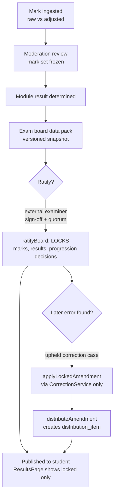

# A Guide to Assessment and Results and Revelation SRS

> Audience: registry/academic-standards leads, product owners, and
> developers evaluating or extending Revelation SRS's assessment and
> results capability.
>
> Structure: Part 1 introduces assessment and results as a UK
> higher-education institutional function. Part 2 describes, precisely and
> with explicit caveats about what's built versus designed, how Revelation
> SRS implements it. Post-ratification correction is covered here as the
> real consumer of the `distribution_item` primitive introduced in *A Guide
> to the Workflow Engine and Revelation SRS*.

## Part 1 — Assessment and results as an institutional function

### From a mark to a fact the institution stands behind

Assessment and results is the chain that turns a piece of student work
into an official academic fact. A **mark** is entered against an
**assessment component** (an exam, a piece of coursework, a specific
weighting of a module's overall assessment); marks are **moderated** —
independently reviewed for consistency and fairness — before a **module
result** is determined; results for a cohort are presented to an **exam
board**, which reviews them (with **external examiner** input, a UK HE
quality-assurance norm), resolves cases requiring judgement (academic
misconduct, exceptional circumstances), and **ratifies** them. Only once
ratified are results **published** to students — and from that point on,
the record is meant to be stable: any further change goes through a
**correction** process specifically because a ratified result is supposed
to mean something.

### Why "locked" matters

The single most important property a credible results system has to
guarantee is that once an exam board has ratified a result, that result
doesn't quietly change. Institutions rely on this for degree classification,
for external examiner assurance, for regulatory reporting, and for
students' own trust in their record. That means the technical design has
to make locking a real, enforced property — not a convention — and has to
provide an explicit, evidenced path for the rare cases where a ratified
result genuinely needs correcting (an appeal upheld, an administrative
error found), so that "ratified" and "immutable except through a governed
correction" both stay true at once.

---

## Part 2 — How Revelation SRS supports assessment and results

The whole chain this Part covers, end to end:

### Marks, distinct from what's actually gets used

`MarkService` (`apps/api/src/platform/assessment/mark-service.ts`) keeps a
mark's **raw** value distinct from its **adjusted** value from the moment
it's entered — directly implementing the "raw, moderated and ratified marks
need distinct states" requirement this domain's own process documentation
calls for. Late-penalty logic (feature-flagged, on by default) and a resit
cap (feature-flagged, off by default, falling back to a hardcoded 40%
UK-convention cap if unconfigured) both apply to the adjusted value, never
silently overwriting the raw one. And penalty logic genuinely respects
reasonable adjustments: before applying a late penalty, `MarkService`
checks for an active `deadline-extension` adjustment — the same
`reasonable_adjustment` record covered in *A Guide to Wellbeing and
Revelation SRS* — so a student's accommodation actually protects their
mark, not just their exam conditions.

`AssessmentComponentService` is comparatively thin: ordinary mutable CRUD
over `assessment_component`, with one real rule — a component becomes
immutable the moment any current mark references it. There's no
versioning, publication, or cohort-protection concept here, despite that
being exactly what this domain's own process documentation asks for.

### Moderation — a deliberately small, dedicated pattern

Moderation is one of the cleanest illustrations, anywhere in Revelation
SRS, of the "not every governed process needs a shared primitive" principle
this guide series keeps returning to. `ModerationService`'s own header
comment states it directly: moderation "uses its own small dedicated
tables, using neither the workflow bridge nor `business_case`, because it's
a well-understood, deterministic academic process." The flow: a stable
`assessment_candidate_attempt` identity is created (since marks themselves
get superseded on correction, something stable is needed to track across
versions), a `mark_set` freezes a fixed list of current mark IDs, a
`moderation_review` starts and tags the exact rule version in force, and
`moderation_sample` records preserve both the before and after value of
anything changed — a direct, working implementation of "any change is
applied with its reason recorded and the original value preserved."

### The two-layer exam board and ratification model

`BoardService.ratifyBoard` is the single most consequential method in this
domain: on success, it **locks** every covered module result, every
covered mark, and every covered progression decision in one transaction,
gated on external-examiner sign-off (on by default) and, if the tenant
opts in, quorum. A newer layer, `BoardAuthorityService`
(implementing BPR-D11), sits *alongside* this — not replacing it — recording
the structured decision chain that proves exactly what a ratification was
based on: declared conflicts and recusals, a computed quorum decision, a
typed board decision (`ratify`/`defer`/`refer-back`) tied to a specific,
versioned data-pack snapshot, and — only from a `ratify`-typed decision — a
formal ratification record, followed by a publication step that only fires
once results are locked.

**One honest, checkable gap**: the data pack itself carries `packHash` and
`ruleManifestRef` columns — added specifically so a board decision could be
tied to a verifiable snapshot of exactly what content and rule set it was
based on — but nothing in the codebase ever populates them.
`current-capabilities.md` says so directly: *"pack_hash/rule_manifest_ref
columns exist but are not yet populated by pack generation."* The
scaffolding for verifiable board evidence is there; the actual hash isn't
computed yet.

### Post-ratification correction — the real distribution_item consumer

Once a result is locked, the only path to changing it is
`CorrectionService`, and it's worth being precise about how careful the
design is: a correction case opens, moves through review, and only once
it's explicitly `upheld` can an amendment actually be applied — dispatched
to whichever service owns the affected record (mark, module result, or
progression decision), each of which exposes an `applyLockedAmendment`
method documented as callable **only** from `CorrectionService`, never from
any route directly. Every amendment writes an append-only before/after
record. And when an amendment needs to reach downstream consumers,
`distributeAmendment` calls `BusinessCaseService#createDistributionItem` —
this is the genuine, real, working consumer of the `distribution_item`
primitive that *A Guide to the Workflow Engine and Revelation SRS*
introduces as a shared building block, and that *A Guide to Wellbeing and
Revelation SRS* describes a since-retired adjustments-side attempt to reuse
without ever finishing the acknowledge/reconcile half. Corrections is where
that primitive is actually exercised.

One access-model detail worth flagging: correction routes are gated by
`exam-board:ratify`, the same permission that governs board ratification —
not a dedicated correction-specific permission — even though the
business-process document's named actor for this process is a "Registry
Officer" or "Authorised Academic Decision Maker," not an exam board role
specifically.

### The student-facing guarantee: only locked results are ever shown

`ResultsPage.tsx` in the portal is a small but important piece of evidence
that "ratified means something" isn't just a backend property: it fetches
a student's module results and explicitly filters to `result.locked ===
true` only, treating an unlocked or missing result as simply absent rather
than surfacing anything provisional. A student never sees a result the
institution hasn't formally stood behind.

### Academic misconduct — deliberately its own small model

Academic misconduct outcomes live in
`apps/api/src/platform/circumstances/misconduct-service.ts` (grouped
alongside exceptional circumstances, covered in *A Guide to Learning,
Engagement and Support and Revelation SRS*) — a third, even smaller pattern
than moderation's: three purpose-built tables recording a case reference,
an outcome, and typed penalty effects that point precisely at the specific
mark or module registration affected, never a narrative description. One
gap worth naming: the dedicated `integrity-officer` role exists in the
system's role catalogue but is granted no permissions at all — misconduct
routes are gated by the ordinary `mark:write`/`mark:read:all` permissions
instead, held by `registry-administrator`, `module-tutor`, and
`integration-service`.

### PGR thesis examination — the staged-authority pattern at its fullest

PGR examination (`ExaminationService`) is the clearest, most complete
expression of the "staged authority, ratification lock" pattern this
domain uses elsewhere in miniature: thesis submission requires an explicit
declaration; examiner nomination requires an independence check and
conflict clearance before the panel can be approved; examiner reports can
only be filed once the panel is confirmed; a viva can only be recorded once
every confirmed examiner has reported; and the outcome can only be
ratified once the viva is held — with outcomes requiring corrections
(minor, major, or resubmission) automatically creating a tracked
correction requirement with its own deadline. The ratified outcome is
explicitly append-only in the schema — any later change has to go through
a linked correction case, never a direct edit — the same discipline this
whole domain applies to taught results, just modelled through the shared
`business_case` primitive rather than bespoke tables.

### Roles in this domain

| Role | What they can do here |
|---|---|
| `module-tutor` | `mark:write`, `mark:read:all` — enters marks; also (perhaps surprisingly) gates misconduct outcome recording |
| `exam-board-chair` | `exam-board:ratify` — the ratification/locking authority, and the same permission that gates post-ratification correction and award conferral |
| `exam-board-member` | Read-only board access — no ratify authority |
| `external-examiner` | Broad read access; sign-off is required for ratification but the role holds no write/ratify permission of its own |
| `integrity-officer` | Declared in the role catalogue but granted **no permissions at all** — misconduct routes use `mark:write`/`mark:read:all` instead |

### Admin surfaces

- **`ExamBoardDetailPage.tsx`** — five tabs, the most relevant being
  **Authority**, gated to roles holding `exam-board:ratify`, hosting the
  conflict-declaration, quorum, and decision/ratification UI directly over
  `BoardAuthorityService`.
- **`ModerationPage.tsx`** — a linear mark-set → review → sample → complete
  wizard, plus a filterable list of open reviews.
- **`PgrExaminationPage.tsx`**, alongside the sibling PGR pages covered
  elsewhere in this series, for the examination arc.

### What isn't tracked, and what's worth knowing before assuming otherwise

Two things worth being direct about: first, neither academic misconduct
nor exam entries/accommodations have a dedicated row in
`docs/product/current-capabilities.md`, despite both being genuinely
implemented — an honest documentation gap, not evidence the capabilities
don't exist. Second, most of this domain's own business-process
documents were drafted before the bulk of this implementation existed, and
several of their stated gaps ("moderation evidence and mark-set version/
sign-off are not first-class," "decision lock... need explicit modelling")
have since been substantially closed — a useful reminder, across this
whole guide series, that a business-process document's "Draft" status and
"Revelation" gap notes describe a point in time, not necessarily the
current state of the code.
