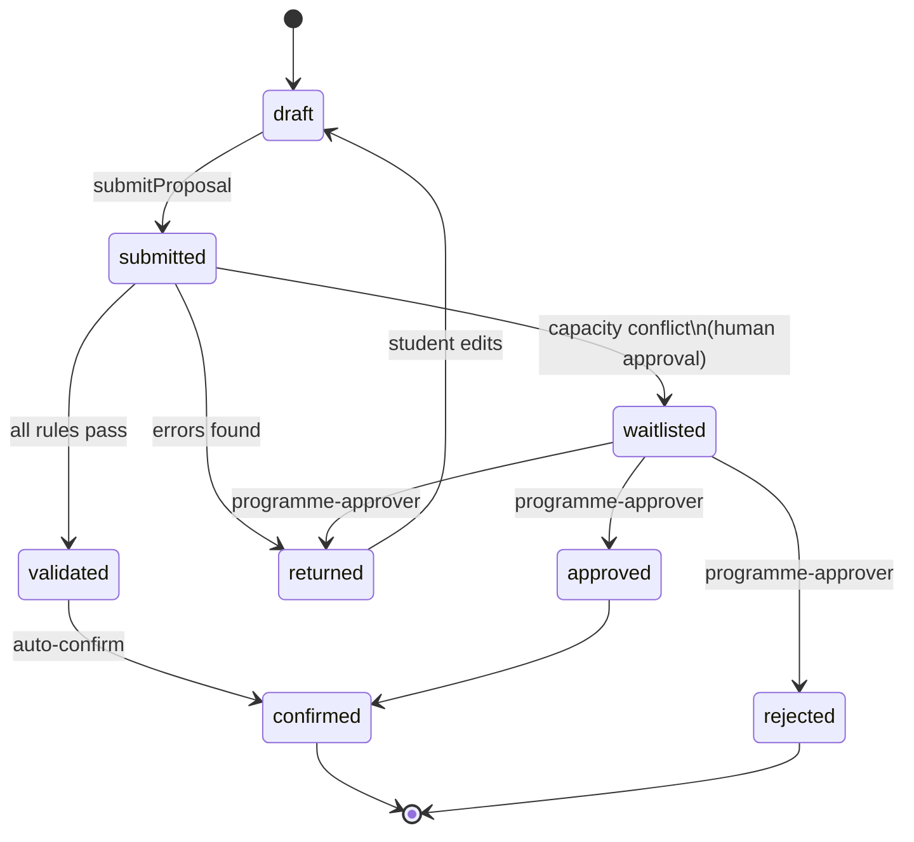

# A Guide to Curriculum and Module Registration and Revelation SRS

> Audience: registry/academic-administration leads, product owners, and
> developers evaluating or extending Revelation SRS's curriculum and
> module-registration capability.
>
> Structure: Part 1 introduces curriculum management and module
> registration as a UK higher-education institutional function. Part 2
> describes, precisely and with explicit caveats about what's built versus
> designed, how Revelation SRS implements it. The
> `module-registration-change-approval` workflow is covered in full,
> file-by-file detail in *A Guide to the Workflow Engine and Revelation
> SRS* — this guide references it rather than repeating it.

## Part 1 — Curriculum and module registration as an institutional function

### What a student is actually registered *for*

Behind "what modules is this student taking" sits a chain of institutional
decisions: a **programme** is built from a **curriculum** — a structured
catalogue of modules, at specified credit levels, published for a given
intake. A student is assigned a **route** through that programme and a set
of applicable **rules** (how many credits are required at each level, which
modules are compulsory, which are chosen from an optional pool). Each
teaching period, the student **selects modules** within those rules, the
institution **validates and approves** the selection (routinely, or with
human judgement when a rule can't automatically resolve — a full module,
say), and only once approved does the student have a confirmed **module
registration** — the record that actually drives assessment, timetabling,
attendance monitoring, and fee calculation for that module.

Later in the year, a student may need to **change** a registration — add a
module, drop one, request a late addition — which is administratively
distinct from the original selection round: it typically needs its own
approval, since it happens outside the normal window and can affect credit
load, prerequisites, or capacity that was already settled.

### Why this needs to be genuinely rule-driven, not just a form

A credible module-registration capability has to enforce real academic
structure — prerequisites, co-requisites, exclusions, credit-load bounds
per mode of study, level composition — automatically wherever it can, and
route to a human only where judgement is genuinely needed (a module at
capacity, an exception to a rule). Getting this balance wrong in either
direction is a real institutional cost: too little automatic enforcement
means invalid registrations reach assessment; too little human escape valve
means legitimate exceptions get stuck. Part 2 shows Revelation SRS's design
for this balance, and — as candidly as the rest of this guide series —
exactly which rules are actually enforced today and which are still just
named in the rule taxonomy, waiting for their check to be written.

---

## Part 2 — How Revelation SRS supports curriculum and module registration

### The shape: proposal, not direct registration

The core design decision here is that a student's module choice for a
period is a **proposal** (`module_selection_proposal`) that moves through a
lifecycle — `draft → submitted → validated → approved | returned |
waitlisted | rejected → confirmed` — before it becomes a real
`module_registration` row. `ModuleSelectionService`
(`apps/api/src/platform/module-selection/service.ts`) owns this lifecycle:
`createProposal` resolves the student's applicable rule set (auto-binding
to the programme's default on first use — see "Curriculum binding," below)
and auto-populates every compulsory module for their level; `addItem`/
`removeItem` are only permitted while the proposal is `draft` or `returned`;
`submitProposal` is where real validation happens.

### What's actually validated — and what isn't yet

`#validateSelection` is the heart of the capability, and it's worth being
precise about exactly what it checks, because the gap between what's
*named* in the rule taxonomy and what's *enforced* is real and specific:

**Enforced today:**
- No duplicate module within the proposal.
- Prerequisite/co-requisite/exclusion, via the existing `module_relationship`
  table (a co-requisite can be satisfied either by a sibling item in the
  same proposal or an existing registration).
- Per-offering capacity — but a shortfall is a **warning**, not a hard
  failure: it sets `capacityConflict = true`, which routes the whole
  proposal to human approval rather than rejecting it outright.
- Diet-group composition (`module_group`/`module_group_member`) — minimum
  and maximum module count and credit bounds per group, and a minimum/
  maximum FHEQ level.
- Mode-of-study-aware credit-load bounds, and level-credit / adjacent-level
  ("trailing" credit outside the student's modal level) limits, via the
  `RulesEngine`.

**Named in the rule taxonomy, but not yet consumed by validation** —
confirmed directly in code, not just asserted in the business-process docs:
- **Timetable clash.** `RulesEngine.getTimetableClashPolicy` exists (default
  `'advisory'`) and is genuinely configurable — but it has no caller
  anywhere in the codebase, because there is no timetable-slot entity to
  check offerings against yet. The policy getter exists ahead of the check
  it would gate.
- **Joint-honours balance** and **repeat-module requirement** — both are
  real entries in the `RuleTypeCode` union, with zero callers in
  `#validateSelection`.
- **Ranked/oversubscribed allocation.** `preference_rank` is a real column
  on `module_selection_proposal_item`, populated by the portal form — but
  nothing reads it. Capacity handling is all-or-nothing per module, not a
  ranked allocation across competing students.
- **Selection windows.** There's no enforcement of an open/close date on
  proposal creation or submission — a proposal can be started and submitted
  at any time. (Registration *windows* are a related but different thing —
  see below.)

This is exactly what `docs/product/current-capabilities.md` states for this
capability, and every clause of it is independently confirmable by grep: a
useful example, across this whole guide series, of the capability matrix
being genuinely accurate rather than aspirational.

### Registration windows — a separate, later gate

`RegistrationWindowService` (`apps/api/src/platform/registration/window-service.ts`)
lets an admin configure an open/close window per academic period, enforced
only when a tenant opts in via `configuration.registrationWindowMode ===
'academic-period'`. The important nuance: this is checked **only inside
`ModuleRegistrationService#createRegistration`** — the point a
`module_registration` row is actually written, whether from direct staff
registration or from `ModuleSelectionService#confirmProposal` — **not** at
proposal creation or submission. So a student can build and submit a
proposal at any time; the window only bites at the final confirmation step,
which is precisely the gap `current-capabilities.md` names as "no
selection-window enforcement on the proposal-submission step itself."

### When a human decides — and who

Two, genuinely distinct human-decision points exist in this domain, each
with its own permission and its own reason for existing:

- **`module-selection:decide`** (`registry-administrator`,
  `programme-approver`) — the exception path when `submitProposal` finds a
  `capacityConflict`: the proposal is `waitlisted` and a
  `module-selection-approval` workflow task is assigned. Approving
  confirms it (creating the registration with `skipCapacityCheck: true` —
  the code comment is explicit about why: *"Capacity was already assessed
  during `#validateSelection`... re-checking it here would race against
  that decision"*); rejecting or returning it sends the student back to
  `draft` with the reasons attached.
- **`module-registration:decide`** (`registry-administrator`,
  `personal-tutor`) — the *later* change-approval path, once a student
  already has a confirmed registration and wants to add or withdraw outside
  the original selection round. This is the `module-registration-change-approval`
  workflow, and it's the one *A Guide to the Workflow Engine and Revelation
  SRS* traces in full file-by-file detail (definition, migration, service,
  decision route, admin page). It's worth naming here precisely because it
  is, in effect, the real implementation behind BP-03-005 ("change a module
  registration") — a process whose own business-process document still
  describes it as an unbuilt gap, unrevised since before this workflow
  existed, even though the capability now genuinely exists.

`programme-approver` exists specifically for the first of these two
decisions; it's a distinct role from `personal-tutor`/`registry-administrator`,
who own the second.

### Curriculum data itself — thinner than the rest

`CatalogueService` (`apps/api/src/platform/catalogue/service.ts`) is
ordinary bitemporal CRUD over `programme`, `module`, `learning_outcome`, and
`module_relationship`, each validated against the value-set system. It's
worth being honest that this is considerably less developed than the
selection/registration machinery built on top of it: there's no
publication/versioning pipeline, no "atomic snapshot" import mechanism, and
no cohort-protection concept — programmes and modules are created and
edited one at a time through ordinary CRUD, not published as a versioned
whole. `programme_route` and `programme_rule_set` (the rule-set entity
`ModuleSelectionService` actually administers) exist as schema, but
`programme_route`-specific management lives with module selection, not with
the catalogue service — a small structural oddity worth knowing if you're
navigating the code.

### Curriculum binding — how a student gets attached to rules

`enrolment_curriculum_binding` (bitemporal) records which programme route
and rule set actually apply to a given enrolment, with a
`decisionAuthorityCode` of `automatic` or a human authority
(`registry-administrator`/`academic-approver`). In the common case this
happens invisibly — `ModuleSelectionService` auto-binds a student to their
programme's default rule set the first time they create a proposal — but a
registry administrator can also set or override it explicitly via `PATCH
/enrolment-curriculum-bindings/:enrolmentId`, which is how exceptions
(a student on a non-standard route, a rule-set override) get handled.

### PGR supervision lives in this domain too — but works completely differently

BP-03-007 (establish PGR supervision) sits in the curriculum-and-module-
registration domain, which can look odd at first — PGR students don't do
diet-based module selection at all. The reason it belongs here is
conceptual, not mechanical: both are ultimately about *establishing what a
student's programme of study actually consists of, and who's academically
responsible for it* — a curriculum binding and a set of module
registrations for a taught student; a supervisory team for a research
student. Mechanically, though, PGR supervision uses a completely different
pattern: `SupervisionService` (`apps/api/src/platform/pgr/supervision-service.ts`)
roots a `pgr_supervision_case` on the shared `business_case` primitive (the
same one this guide series has already met via corrections, identity
resolution, and DSAR handling), not the Temporal-shaped workflow bridge.
Supervisor nominations are working data until a director's decision
approves them; only then are `staff_assignment` rows created — deliberately,
so an incomplete or unapproved supervisory team is never representable as a
student's *current* one. Working arrangements, team-size rules, and role
eligibility rules — three of BP-03-007's four open questions — remain
genuinely unaddressed: there's no schema or configuration for any of them
yet.

### Admin and portal surfaces

- **`ModuleSelectionProposalsPage.tsx`** — the queue (default filter
  `waitlisted`), with per-item validation messages and Approve/Return/
  Reject actions requiring a reason.
- **`RegistrationWindowsPage.tsx`** — per-period window CRUD, with the UI
  itself stating plainly that it's only enforced when a tenant has opted
  in.
- **`ModuleSelectionPage.tsx`** (portal) — the proposal-based selection
  flow, additive alongside the older direct-registration `ModuleAddPage.tsx`.
- **`ModulesPage.tsx`** (portal) — confirmed registrations, with the
  **Withdraw** action that's the entry point into the change-approval
  workflow.

### Roles in this domain

| Role | What they can do here |
|---|---|
| `student` | `module-selection:write:own` — create, edit, and submit their own proposals |
| `registry-administrator` | Read/write everything in this domain; `module-registration:decide` alongside `personal-tutor` |
| `personal-tutor` | `module-registration:decide` — approves or rejects portal-initiated add/withdraw change requests |
| `programme-approver` | `module-selection:decide` — the capacity-exception path for waitlisted proposals; `catalogue:read`, so programmes and modules show by name |
| `tenant-administrator` | `module-selection:configure` — defines diet groups, rule sets, credit-load rules |
| `module-tutor`, `exam-board-member`, `exam-board-chair`, `external-examiner`, `integration-service` | `catalogue:read` and, for tutors, `module-registration:read:all` — read-only |

`programme-approver` and `personal-tutor` are deliberately distinct roles
for two different decision points in this domain — the capacity exception
during initial selection, and a later change to an already-confirmed
registration.

### What this means in practice

The parts of this domain closest to a student's actual choices — selection,
validation, capacity exceptions, and later changes — are genuinely well
built, rule-driven, and tested, including the honest edge cases (a
capacity conflict routes to a person; a rule the system can't yet check
just isn't checked, rather than being silently assumed). The parts further
from the student — curriculum publication and cohort protection — are
comparatively undeveloped, and the specific rule types still missing
(timetable clash, joint-honours balance, ranked allocation) are exactly the
kind of thing that shows up as real institutional pain once a deployment
scales past a simple single-honours cohort with plentiful capacity.
