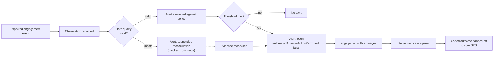

# A Guide to Learning, Engagement and Support and Revelation SRS

> Audience: registry/student-support leads, product owners, and developers
> evaluating or extending Revelation SRS's engagement, exceptional-
> circumstances, and misconduct capability.
>
> Structure: Part 1 introduces this domain as a UK higher-education
> institutional function. Part 2 ties its parts together and describes,
> precisely and with explicit caveats, how Revelation SRS implements the
> parts not already covered elsewhere. Reasonable adjustments, disability
> support, and mental health are covered in full in *A Guide to Wellbeing
> and Revelation SRS*; the attendance/engagement admin workspace is
> covered at a walkthrough level in `academic-engagement-workspace.md`.
> This guide is the connective layer between them, plus the two
> capabilities neither of those documents covers: exceptional
> circumstances and academic misconduct.

## Part 1 — Learning, engagement and support as an institutional function

### A wider domain than "wellbeing"

This domain covers everything an institution does to notice when a student
is struggling and respond appropriately — which is broader than wellbeing
casework alone. It includes **monitoring attendance and academic
engagement** (spotting non-engagement early, often before a student asks
for help), **investigating and responding to it** appropriately (a tutor
conversation, a referral, in serious cases a report to a visa sponsor),
**exceptional circumstances** (a time-bounded event affecting a specific
assessment, weighed separately from the raw mark), and, at the more
serious end, **academic misconduct** (where a penalty needs to be applied
to a specific mark or registration, distinct from a support response). PGR
progress review sits here too, conceptually, for the same reason PGR
supervision sits in the curriculum domain: it's the research-degree
equivalent of the periodic checking-in a taught programme does through
attendance monitoring.

### The thread that runs through all of it

Every one of these processes shares the same underlying tension: the
institution needs enough signal to act — a tutor to be told a student
hasn't engaged, a sponsor to be told about a visa-relevant compliance
concern, an exam board to see that a circumstance was considered — without
that signal carrying more than the minimum necessary detail. A tutor
doesn't need a diagnosis to know a deadline extension is in force; an exam
board doesn't need clinical narrative to see an exceptional-circumstances
outcome. This is the same "minimum necessary disclosure" principle *A
Guide to Wellbeing and Revelation SRS* centres its whole account on — this
guide shows it operating across the domain's other capabilities too.

---

## Part 2 — How Revelation SRS supports learning, engagement and support

### Attendance and engagement — a second real, separately-deployed module

`modules/attendance` is worth naming precisely: it's a second genuine
example of the separately-deployable, own-database module pattern the
wellbeing guide introduces — not a one-off. Its pipeline runs
**expected event → observation → alert → intervention case**, and it's
built with the same care about evidence quality the wellbeing guide's
principles would predict: a data-quality code on every observation
(`valid`/`missing`/`duplicate`/`disputed`/`conflicting`/`quarantined`), a
correction mechanism that never overwrites — it closes the current
version and appends a revision record with a reason — and, critically, an
alert whose evidence is unsafe (any of those non-`valid` quality codes) is
created as `suspended-reconciliation`, a status that structurally blocks
it from being triaged into an intervention until the evidence is
reconciled. Every alert also carries an explicit `automatedAdverseActionPermitted:
false` flag and a `human-review-required` decision marker baked into its
own explanation — the system is designed so an alert can never, by
itself, trigger a consequence.

Two boundaries are enforced in code, not just policy. First, a hard content
filter rejects any intervention contact-attempt note that matches medical,
disability, safeguarding, self-harm, or mental-health language — the exact
"never enter this narrative in general engagement notes" instruction the
wellbeing guide states, checked automatically rather than left to staff
judgement. Second, the module's engagement-outcome handoff to core SRS
mirrors the wellbeing module's own pattern almost exactly: core SRS
receives only a coded outcome (`at-risk`, `non-engagement`,
`referred-sponsor-compliance`, and similar), idempotent on the alert and
outcome code, over its own dedicated table — never a join into the
attendance module's case or contact-log detail. When that outcome is
`referred-sponsor-compliance`, it feeds directly into the same
independently-authorised UKVI sponsor-decision chain covered in *A Guide
to Regulatory and Statutory Reporting and Revelation SRS*. The full admin
workspace built on this pipeline — the alert queue, evidence worklist,
intervention case, and sponsor-compliance hand-off — is already documented
at a walkthrough level in `docs/user-guides/academic-engagement-workspace.md`.

### Exceptional circumstances — genuinely two systems, loosely connected

This is worth correcting precisely against what *A Guide to Wellbeing and
Revelation SRS* said in passing: exceptional circumstances is not one
system, it's two, connected by a narrow, one-directional handoff.

**Core SRS's own path** is a simple outcome record — a student can
self-submit a circumstances claim directly through the portal, or a
registry administrator can write one directly; either way, it's just an
outcome code, a determination date, and notes, with no built-in case
lifecycle of its own. **The wellbeing module's `ec_claim`** is where the
real casework lives: a full lifecycle (submitted → evidence pending or
under review → upheld, not upheld, or partially upheld), an evidence
review step that automatically advances the claim once evidence is judged
sufficient, and a structured determination recording exactly which modules
were affected and how. The connection between the two is deliberately
narrow: a determination only gets handed off to core SRS's simple record
if it's upheld or partially upheld — a `not_upheld` determination stays
local to the module entirely, on the same "core SRS only ever sees the
administrative fact" principle this whole guide series keeps returning to.

Two things worth flagging plainly rather than glossing over: the wellbeing
module's EC-claim routes have no permission gate specific to EC casework
at all — every other route file in that module checks a permission before
acting; this one, notably, doesn't (a valid login is still required, just
no role-specific check beyond that). And there's no admin interface
anywhere in `apps/admin` for the module's EC-claim casework — unlike
reasonable adjustments, which got a full case-management page, EC casework
in the wellbeing module is API-only today.

### Academic misconduct — deliberately its own small model, in an unexpected place

Misconduct outcomes are recorded through their own small, purpose-built
set of tables — a case reference, an outcome, and typed penalty effects
that point precisely at the specific mark or module registration a
penalty applies to, never a narrative description. It's worth knowing
where this actually lives: the same core-SRS code area as exceptional
circumstances, gated by assessment permissions rather than anything
circumstances-specific, and covered in more depth (since it's arguably as
much an assessment-domain concern as an engagement one) in *A Guide to
Assessment and Results and Revelation SRS*. Misconduct outcome-recording
is real and tested, but genuinely undocumented at the product-capability
level, and has no dedicated admin or portal UI.

### The distribution capability that used to sit here — now retired

BP-04-006, "distribute an approved support outcome," described a shared
per-target delivery mechanism for adjustment and exceptional-circumstances
outcomes alike. As *A Guide to Wellbeing and Revelation SRS* now documents
in full, that mechanism (`support_outcome`/`distribution_item`) was
retired in this same working session — it never reached functional parity
with the simpler, already-live `adjustment_distribution` path, which
remains the sole working outcome-distribution mechanism in the system
today.

### Roles, and who can see what

| Role | What they can do here |
|---|---|
| `engagement-officer` | Full read/write/manage/refer access across attendance and intervention casework |
| `personal-tutor` | Read-only visibility into the same surface, plus decision authority for module-registration and identity-change requests elsewhere in this guide series |
| `wellbeing-advisor` | Sees every student's EC outcome (the coded fact) via core SRS; **no** permission specific to EC casework in the wellbeing module, and cannot write to core SRS's own EC record |
| `registry-administrator` | The only role that can write directly to core SRS's simple EC record; broad read access throughout |
| `module-tutor` | Holds the `mark:write`/`mark:read:all` permissions that (perhaps surprisingly) also gate misconduct outcomes |
| *(none)* | No misconduct-specific role exists, and the wellbeing module's `ec-claims` routes have no permission gate at all beyond a valid login |

### What this means in practice

Most of the depth in this domain — attendance/engagement monitoring,
reasonable adjustments, disability support, mental health — is covered
thoroughly in the two documents this guide points to rather than repeats.
What's genuinely new here is the shape of exceptional circumstances as two
systems rather than one, the quiet but real existence of a separate
misconduct-recording capability, and the now-closed loop on support-outcome
distribution. Taken together, this domain is one of the stronger examples
in Revelation SRS of the minimum-necessary-disclosure principle actually
being enforced in code — evidence-quality gating, content filtering,
independent authorisation, and coded-not-narrative handoffs all show up
here, not just in the wellbeing module this guide series started with.
