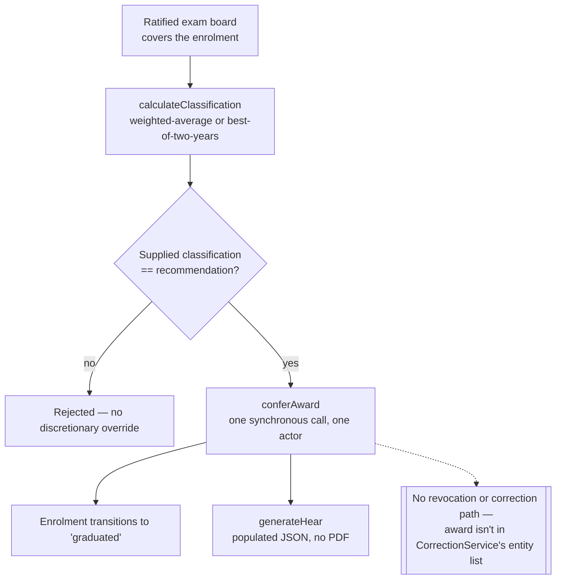

# A Guide to Progression, Awards and Graduation and Revelation SRS

> Audience: registry/academic-standards leads, product owners, and
> developers evaluating or extending Revelation SRS's progression, awards
> and graduation capability.
>
> Structure: Part 1 introduces progression, awards and graduation as a UK
> higher-education institutional function. Part 2 describes, precisely and
> with explicit caveats about what's built versus designed, how Revelation
> SRS implements it.

## Part 1 — Progression, awards and graduation as an institutional function

### From "did they pass the year" to "what did they earn"

Once a year's results are ratified, an institution has to answer a
sequence of increasingly consequential questions. **Progression**: has
this student earned enough credit, at the right level, to move to the next
year of study — outright, with compensation for a narrowly failed module,
or not at all? **Reassessment**: for students who haven't, what's their
entitlement — a resit, a referral, a full repeat of the year, with or
without attending again — and what does that mean for their fees,
timetable, and (for international students) their visa? Eventually,
**award**: has the student completed enough of their programme, to what
standard, to be conferred a named qualification and classification? And
finally, **graduation**: the ceremonial and documentary recognition of
that award — a certificate, a transcript, a Higher Education Achievement
Report (HEAR), and, for most students, a ceremony.

### Why the award and the ceremony have to stay separate

A subtle but important design principle in this domain: **conferring an
award and attending a graduation ceremony are not the same event**, and
a well-designed system keeps them structurally apart. A student who can't
attend their ceremony — illness, distance, timing — must never have that
look, anywhere in their record, like an unconferred degree. Getting this
separation right is as much a matter of correct data modelling as it is
process design: the award is the fact; the ceremony is a celebration of a
fact that already, unconditionally, exists.

---

## Part 2 — How Revelation SRS supports progression, awards and graduation

### In short: the core calculations are real and tested; almost everything around them is thin or missing

Every one of this domain's six processes has a genuine, working
calculation engine behind its central question — but every one of them
also stops well short of the fuller process its own business-process
documentation describes, and (with one clear exception) none of them has
any user interface at all.

### Progression — a real, deterministic calculation, with no board around it

`ProgressionService.evaluateProgression` (`apps/api/src/platform/progression/progression-service.ts`)
is a genuine implementation of UK HE progression logic: it pulls a
student's ratified module outcomes for the year, reads
tenant/programme-configured rules (required credits, compensation
threshold and credit cap, condonement threshold) from the shared
`RulesEngine`, and derives a decision — `progress` if enough credit was
earned outright or through compensation/condonation; `resit` if some
credit remains genuinely unresolved; `repeat-year` otherwise. The decision
is stored bitemporally, locked once set (with the same
`applyLockedAmendment`-via-`CorrectionService`-only escape hatch used
throughout assessment), and comes with a best-effort explanatory evidence
record — a rule snapshot and the exact credit arithmetic behind the
decision, so "why did this student get this outcome" has a real answer.

What's missing is everything BP-06-001 describes *around* that calculation:
there's no Progression Board record, no distinct place to capture board
discretion separate from the automatic calculation, and no student-facing
exception-submission step. `POST /enrolments/:enrolmentId/progression` is
a single, synchronous, `registry-administrator`-only call — API-only, with
no admin or portal page anywhere that surfaces it.

### Reassessment — deliberately, or perhaps just currently, distributed rather than governed

There is no single "repeat-study plan" record. What BP-06-002 calls for —
attempt entitlement, next-attempt timing, a repeat-with-or-without-
attendance distinction, fee/timetable/visa consequences — is instead
spread thinly across fields that already exist for other reasons: a
module result's own `resultCode` (which includes `resit-required`), a
candidate attempt's type (`first-sit`/`resit`/`repeat`), and the
progression decision's own `resit`/`repeat-year` codes. There's no
distinct "referral" outcome separate from resit, and no consequence
recording of any kind. This is one of the more clearly named gaps in the
business-process document's own self-assessment, and it holds up: nothing
in the schema or services offers a first-class reassessment-plan record.

### Awards — real classification and conferral, in one step rather than two

`AwardService.calculateClassification` computes a genuine UK-convention
classification recommendation: a configurable algorithm (weighted average
by default, or best-of-two-years), mapped to a boundary table that falls
back to the familiar `70/60/50/40` UK degree-classification bands if
nothing more specific is configured. `conferAward` is where the design
choice worth naming plainly sits: it requires a *ratified, covering* exam
board, requires the classification supplied to exactly match the
freshly-recalculated recommendation (no discretionary override path), and
performs the whole thing as one synchronous call by one actor — not the
three-step recommend → confer-with-authority → immutable-fact sequence
BP-06-003 describes. There's also no revocation or correction path for a
conferred award at all: `award` isn't even in the list of entity types
`CorrectionService` knows how to amend, despite the business process's own
exception flow explicitly anticipating that a conferred record might need
correcting without ever looking unconferred.

Award conferral is gated by `exam-board:ratify` — the same permission that
governs board ratification — rather than any dedicated award permission,
another instance of this codebase reusing an adjacent permission rather
than minting a new one.

### HEAR — a genuine, populated data artefact, not a document

`HearService.generateHear` is worth being precise about, because it's easy
to either overstate or understate what it does. It **is** real: it
assembles a genuinely complete, populated structure — institution,
verified student identity, award details, and every ratified module
result the student achieved — stored as JSON on the award record, with
careful, correctly-scoped access control (a student can only fetch their
own). What it is **not** is document generation in the sense BP-06-004
means: there's no PDF or any other rendered file anywhere in the
codebase, no signing, no secure delivery channel, and no
issue/replace/revoke/verify lifecycle. There's no certificate or
transcript concept at all — only this one HEAR data structure. A column
for tracking certificate issuance exists on the `award` table; nothing in
the codebase ever writes to it.

### Graduation ceremonies — not modelled

This is the cleanest, most complete gap in the domain: there is no
ceremony, invitation, attendance, or allocation concept anywhere in the
schema or code. "Graduated," in Revelation SRS today, is purely an
enrolment status that's set automatically the moment an award is
conferred — which means the separation this guide's Part 1 opened with
(a ceremony no-show must never look like an unconferred award) is, in a
sense, trivially true here: there's no ceremony record to conflate with
the award in the first place, because there's no ceremony record at all.
This is worth stating candidly rather than reading as either a strength
or a failure — it's simply unbuilt.

### PGR completion — the one process built to match its documentation closely

Recording a successful PGR completion is the exception to almost
everything above, and follows the staged-authority pattern this guide
series has already met in the assessment and workflow-engine guides:
`CompletionService` requires every outstanding thesis correction to be
completed before a completion case can even open, requires an explicit
IP declaration before a final deposit can be recorded, requires the
deposit before completion itself can be recorded — and, deliberately, does
**not** confer the award automatically. Conferral is an explicit further
step, calling the same `AwardService` machinery used for taught awards, and
completion also closes out the student's supervisory team assignments and
notifies the institution's research information system. This is the one
part of this domain with real admin and portal surfaces (`PgrCompletionPage.tsx`
and a "Research degree" card in the student portal) and demo data behind
it — genuinely finished, not just calculated.

### Roles in this domain

| Role | What they can do here |
|---|---|
| `registry-administrator` | Runs progression evaluation (`progression:write`); holds `exam-board:ratify`, so can also confer taught awards |
| `exam-board-chair` | `exam-board:ratify` — the same permission that gates award conferral as gates board ratification itself, reused rather than a dedicated award permission |
| `pgr-director` | `award:confer:research` — the dedicated (only dedicated) award permission in this domain, for research-degree conferral |
| `student` | Reads their own HEAR once generated, with an explicit ownership check — no write access anywhere in this domain |

Every capability in this domain outside PGR completion is reachable only
through the API — there's no admin or portal screen gating any of these
permissions in practice, because there's no screen at all.

### What this means in practice

`docs/product/current-capabilities.md` summarises this domain in one
sentence that holds up precisely against the code: *"Reassessment plan,
recommendation/conferment separation, issued document lifecycle and
ceremony are absent."* If you're evaluating this capability: trust the
calculations — progression and classification logic are genuine,
UK-convention-aware, and evidenced — but don't expect a board workflow, a
reassessment record, a rendered certificate, or anything resembling
ceremony administration. Everything outside PGR completion is reachable
only through the API today; there is no admin or portal screen for
progression, award conferral, or HEAR generation at all.
