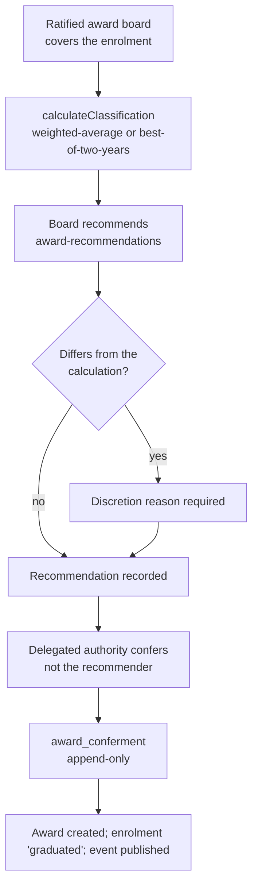

# A Guide to Progression, Awards and Graduation and Revelation SRS

> Audience: registry/academic-standards leads, product owners, and
> developers evaluating or extending Revelation SRS's progression, awards
> and graduation capability.
>
> Structure: Part 1 introduces progression, awards and graduation as a UK
> higher-education institutional function. Part 2 describes, precisely and
> with explicit caveats about what's built versus designed, how Revelation
> SRS implements it.

## Part 1 — Progression, awards and graduation as an institutional function

### From "did they pass the year" to "what did they earn"

Once a year's results are ratified, an institution has to answer a
sequence of increasingly consequential questions. **Progression**: has
this student earned enough credit, at the right level, to move to the next
year of study — outright, with compensation for a narrowly failed module,
or not at all? **Reassessment**: for students who haven't, what's their
entitlement — a resit, a referral, a full repeat of the year, with or
without attending again — and what does that mean for their fees,
timetable, and (for international students) their visa? Eventually,
**award**: has the student completed enough of their programme, to what
standard, to be conferred a named qualification and classification? And
finally, **graduation**: the ceremonial and documentary recognition of
that award — a certificate, a transcript, a Higher Education Achievement
Report (HEAR), and, for most students, a ceremony.

### Why the award and the ceremony have to stay separate

A subtle but important design principle in this domain: **conferring an
award and attending a graduation ceremony are not the same event**, and
a well-designed system keeps them structurally apart. A student who can't
attend their ceremony — illness, distance, timing — must never have that
look, anywhere in their record, like an unconferred degree. Getting this
separation right is as much a matter of correct data modelling as it is
process design: the award is the fact; the ceremony is a celebration of a
fact that already, unconditionally, exists.

---

## Part 2 — How Revelation SRS supports progression, awards and graduation

### In short: real calculations, and since November 2026 the governed records around them

Every one of this domain's six processes has a genuine calculation behind
its central question. Since 16 November 2026 the governed records the
business processes call for also exist — reassessment plans, a separate
recommendation and conferment, an award-document lifecycle and graduation
cycles — through the API. What is still thin is the wiring between them and
the screens: outside PGR completion, none of this has an admin or portal
page yet.

### Progression — a real, deterministic calculation, with no board around it

`ProgressionService.evaluateProgression` (`apps/api/src/platform/progression/progression-service.ts`)
is a genuine implementation of UK HE progression logic: it pulls a
student's ratified module outcomes for the year, reads
tenant/programme-configured rules (required credits, compensation
threshold and credit cap, condonement threshold) from the shared
`RulesEngine`, and derives a decision — `progress` if enough credit was
earned outright or through compensation/condonation; `resit` if some
credit remains genuinely unresolved; `repeat-year` otherwise. The decision
is stored bitemporally, locked once set (with the same
`applyLockedAmendment`-via-`CorrectionService`-only escape hatch used
throughout assessment), and comes with a best-effort explanatory evidence
record — a rule snapshot and the exact credit arithmetic behind the
decision, so "why did this student get this outcome" has a real answer.

What's missing is everything BP-06-001 describes *around* that calculation:
there's no Progression Board record, no distinct place to capture board
discretion separate from the automatic calculation, and no student-facing
exception-submission step. `POST /enrolments/:enrolmentId/progression` is
a single, synchronous, `registry-administrator`-only call — API-only, with
no admin or portal page anywhere that surfaces it.

### Reassessment — a governed plan that follows a ratified decision

Since 16 November 2026 there is a first-class `reassessment_plan` record
(BPR-D14). A plan can only be created from a **ratified** progression
decision, and only of a type that decision allows: a `resit` decision can
lead to resit without attendance, referral, a repeat module, a deferral or
an exceptional additional attempt; a `repeat-year` decision to a repeat
stage. The plan carries its attempt number (a deferral keeps first-attempt
treatment and does not use one up), any mark cap and a due date, and is
closed as completed, expired or cancelled — never overwritten.

What's still missing is the wiring around it: plans are created by hand
(`POST /progression-decisions/{id}/reassessment-plans`), not at
ratification; they are not yet linked to the new attempt's marks; fee,
timetable and visa consequences are not recorded; and there is no screen.

### Awards — a recommendation, then a separate conferment

`AwardService.calculateClassification` computes a genuine UK-convention
classification: a configurable algorithm (weighted average by default, or
best-of-two-years), mapped to a boundary table that falls back to the
familiar `70/60/50/40` bands if nothing more specific is configured.

Since 16 November 2026 conferral follows BP-06-003's two steps (BPR-D14):

1. The board **recommends** (`POST /enrolments/{id}/award-recommendations`,
   `award:recommend`). The recommendation is bound to the calculated
   classification; recommending a different one needs a recorded
   discretion reason. Aegrotat and posthumous awards must cite the policy
   that allows them. Every recommendation needs a ratified award board
   that covers the student, and there is at most one open recommendation
   per enrolment.
2. A **delegated authority who is not the recommender** confers it
   (`POST /award-recommendations/{id}/conferment`, `award:confer`). That
   writes an append-only `award_conferment` row (a database trigger
   refuses updates and deletes), creates the award, graduates the
   enrolment and publishes `srs.award.conferred`.

The old one-step `POST /enrolments/{id}/award`, which let one person
confer directly, is retired: it now returns `410 Gone` and names the two
routes above. A conferred award still has no revocation or correction
path (`award` is not in `CorrectionService`'s entity list).

### HEAR and award documents

`HearService.generateHear` assembles a genuinely complete HEAR structure —
institution, verified identity, award details and every ratified module
result — stored as JSON on the award, with a student able to fetch only
their own.

Since 16 November 2026 there is also an award-document lifecycle
(BPR-D15): certificates, transcripts, HEARs and award letters are issued as
numbered `document_issue` rows, each with the exact content it states, a
SHA-256 hash of that content and a verification code. A replacement or
corrected-name issue supersedes the previous one without rewriting it;
revocation is append-only; every verification check is logged and discloses
only what the outcome allows. What it is **not** yet is document rendering:
there is no PDF, no cryptographic signature and no public verification page
(verification is an authenticated API).

### Graduation ceremonies — invitations, allocation and attendance

Graduation is modelled separately from the award (BPR-D15), which is the
separation Part 1 opened with. A graduation cycle invites everyone whose
award was conferred in its window (re-inviting deferrals, skipping anyone
already presented); students answer their own invitation (attending, in
absentia, deferred or declined); the graduation team allocates attending
graduands to ceremonies within capacity and guest limits, freezes the
presentation list, and records attendance afterwards. None of that ever
changes the award: a full ceremony or an absence moves attendance, not
academic status. There is no ticketing and no screen yet.

### PGR completion — the one process built to match its documentation closely

Recording a successful PGR completion is the exception to almost
everything above, and follows the staged-authority pattern this guide
series has already met in the assessment and workflow-engine guides:
`CompletionService` requires every outstanding thesis correction to be
completed before a completion case can even open, requires an explicit
IP declaration before a final deposit can be recorded, requires the
deposit before completion itself can be recorded — and, deliberately, does
**not** confer the award automatically. Conferral is an explicit further
step, calling the same `AwardService` machinery used for taught awards, and
completion also closes out the student's supervisory team assignments and
notifies the institution's research information system. This is the one
part of this domain with real admin and portal surfaces (`PgrCompletionPage.tsx`
and a "Research degree" card in the student portal) and demo data behind
it — genuinely finished, not just calculated.

### Roles in this domain

| Role | What they can do here |
|---|---|
| `registry-administrator` | Runs progression evaluation (`progression:write`); `award:recommend` and `award:confer` (never both on the same award); reassessment plans, documents and graduation |
| `exam-board-chair` | `exam-board:ratify` for board ratification; `award:recommend` to record the board's award recommendation |
| `tenant-administrator` | `award:confer` as a delegated conferment authority |
| `pgr-director` | `award:confer:research`, for research-degree conferral through the PGR completion case |
| `student` | Reads their own HEAR and award documents; answers their own graduation invitation |

Every capability in this domain outside PGR completion is reachable only
through the API — there's no admin or portal screen gating any of these
permissions in practice, because there's no screen at all.

### What this means in practice

If you're evaluating this capability: trust the calculations — progression
and classification are genuine, UK-convention-aware and evidenced — and
expect the governed records BP-06-002 to BP-06-005 describe to exist and be
enforced through the API: a recommendation that one person makes and
another confers, append-only conferment, reassessment plans, issued and
revocable documents, and graduation kept apart from the award. Don't
expect a progression-board workflow, rendered or signed certificates,
automatic plan creation at ratification, or any screen outside PGR
completion. `docs/product/current-capabilities.md` keeps the current list.
