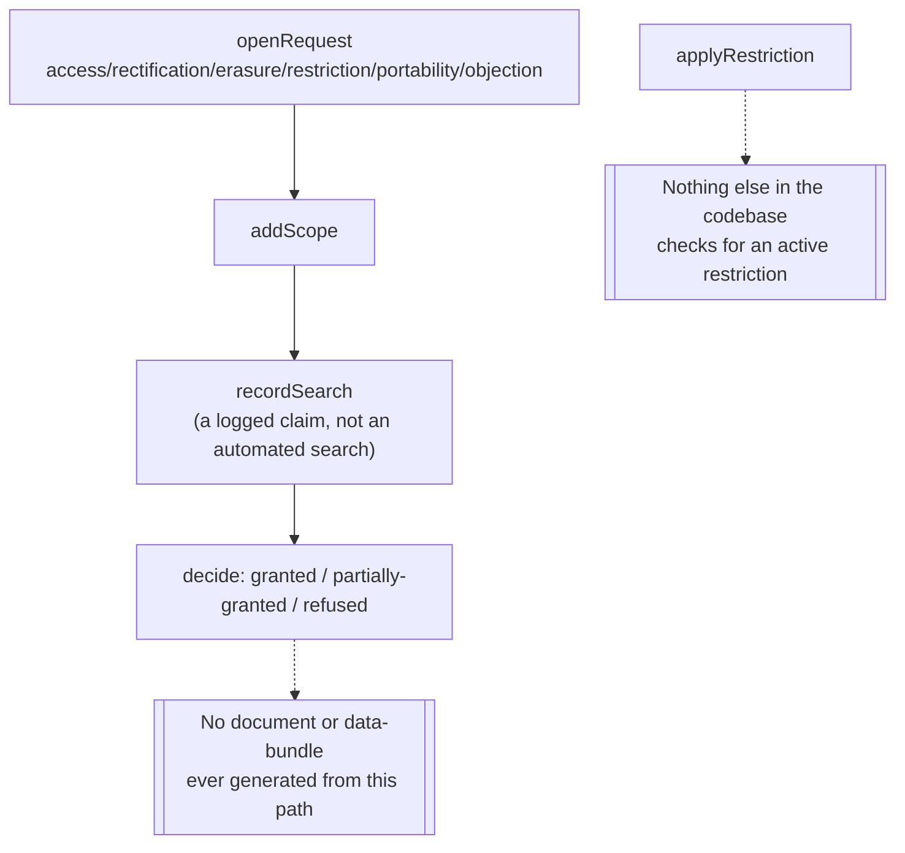

# A Guide to Record Governance and Lifecycle and Revelation SRS

> Audience: data protection officers, registry leads, product owners, and
> developers evaluating or extending Revelation SRS's record-governance
> capability.
>
> Structure: Part 1 introduces record governance and lifecycle as an
> institutional and legal function. Part 2 describes, precisely and with
> explicit caveats about what's built versus designed, how Revelation SRS
> implements it.

## Part 1 — Record governance and lifecycle as an institutional function

### A student record outlives the reasons it was created

A student record isn't just written once and read afterward — it has to
be actively governed for as long as it exists. Sometimes two records turn
out to be the same person and need **resolving** into one. Personal or
enrolment data sometimes needs **correcting**. Individuals have statutory
**rights** over their own data — to access it, to have it corrected, to
have its processing restricted, in some cases to have it erased — that an
institution has to be able to action, not just acknowledge. Records that
have served their purpose need **retaining, archiving, and eventually
disposing of**, on a schedule, not indefinitely. And every one of these
governance actions — along with every material change to the record
itself — needs to be **auditable**, so an institution can demonstrate,
after the fact, exactly what happened to a record and who did it.

### Why this has to be more rigorous than ordinary CRUD

Record governance sits closer to legal obligation than almost anything
else an SRS does — UK GDPR gives individuals real, enforceable rights over
their data, and an institution has to be able to *prove* it handled a
request correctly, not just claim to have. That means the underlying
system needs genuine evidence trails: who decided what, on what basis,
when; whether a hold blocked a disposal that should have been blocked;
whether an audit record has been tampered with. A governance capability
that can't produce that evidence when asked isn't really providing
governance, whatever its user interface looks like.

---

## Part 2 — How Revelation SRS supports record governance and lifecycle

### The shared foundation: `business_case`, mostly used for its case shell rather than its lifecycle

Four of this domain's capabilities — identity resolution, data correction,
individual rights requests, and audit review — are rooted on the same
shared `business_case` primitive this guide series has already met via
PGR and corrections. It's worth being precise about how it's actually used
here, because it's thinner than in those other domains: every case opened
for these four capabilities is created and simply stays `open` — none of
the services that root cases on this primitive ever call the method that
would advance a case's status. Decisions are recorded as real, separate,
append-only facts alongside the case (an identity-resolution decision, a
rights decision, an audit finding), but the case shell's own status field
is, in practice, inert for all four of them. Worth knowing if you're
querying by case status expecting it to reflect where a case actually is.

### Identity resolution — real decision discipline, incomplete propagation

`IdentityResolutionService` gets one important design choice right in a
way worth calling out: a merge decision is never derived automatically
from a match score, however confident. Candidates are generated and
scored, but a decision always requires an explicit, authorised human call
— an unattributed "the system decided this" outcome is structurally
impossible here. What's incomplete is what happens *after* a merge
decision: linking two person records creates a redirect record marking
one as merged into the other, but nothing in the codebase ever propagates
that redirect anywhere — dependent records elsewhere in the system aren't
updated to point at the surviving identity. The redirect is created
faithfully; nothing consumes it yet.

**Correcting personal or enrolment data is thinner still.** Opening a
correction case records that a specific field on a specific record needs
correcting — but there is no method anywhere that actually applies a
correction through this path. It's a label, not a mechanism. The real
correction-application engine that exists in this codebase —
`CorrectionService`, covered in *A Guide to Assessment and Results and
Revelation SRS* — does genuine, evidenced, distributed amendment, but only
for marks, module results, and progression decisions, not general
personal or enrolment data. So two unconnected "correction" capabilities
exist in Revelation SRS today, and neither one fully delivers what this
particular process asks for on its own.

### Subject rights requests — real case tracking, no actual export

`RightsRequestService` gives a data-protection team a genuine, working
case flow for the full range of UK GDPR rights — access, rectification,
erasure, restriction, portability, objection — with scope recording, a
search-manifest step, and a decision (granted, partially granted, or
refused) with an optional legal basis. It's worth being direct about what
"fulfilling" a request actually produces here, though: the search step is
a logged claim ("I searched system X and found N records"), not an
automated search, and there's no document or data-bundle generation
anywhere in this service — no export a data-protection officer could
actually hand to a requester. This is a genuine, useful contrast with the
wellbeing module's own subject-access mechanism, covered in *A Guide to
Wellbeing and Revelation SRS*, which really does assemble and return every
wellbeing-owned record for a person. Core SRS has no equivalent for the
rest of the student record yet.

**Processing restrictions are recorded, but not enforced anywhere else.**
A restriction can be applied and lifted, and is logged faithfully — but
nothing else in the codebase, no API, extract, or automated process,
actually checks for an active restriction before acting. It's a marker
that exists without yet being consulted.

### Retention and disposal — two systems, one destructive, one not

Two genuinely separate retention mechanisms coexist, deliberately, per an
explicit comment in the code: an older, automatic, tenant-wide
anonymisation sweep, and a newer, general-purpose, non-destructive
scheduling model.

The **older sweep** is the one with real teeth: it identifies students
whose enrolment ended long enough ago to be past the retention period,
skips anyone with a live award (permanently preserving award and
transcript data), and for everyone else genuinely, irreversibly
anonymises their identity and address data — nulling or tokenising names,
dates of birth, contact details — with every action recorded to the audit
trail. This is real, destructive, and worth taking seriously in any
deployment.

The **newer model** — configurable retention schedules assigned per
record, holds, and disposition records — is deliberately non-destructive
in comparison, but genuinely enforces one important thing: a disposal is
actually blocked while any hold against that assignment remains active,
checked in code, not just policy. What it doesn't do is execute anything
— recording a disposition is a logged claim that disposal happened by
some other means, not an action that itself deletes, anonymises, or
transfers anything.

### Audit — a real, automatic hash chain; verification designed for but not built

Every audit write in Revelation SRS goes through one method, and that
method is worth understanding precisely: it computes a SHA-256 hash over
the new record plus the previous record's hash, chaining every entry for
a tenant together — the same pattern used by tamper-evident logs
generally. This happens automatically, for every audit write, without any
calling code needing to change. A "seal" operation can snapshot a hash
over a range of the chain for later comparison. What's genuinely missing
is the other half of what makes a hash chain valuable: there is no code
anywhere that actually re-verifies the chain, detects a tampered record,
or exposes a "check integrity" action of any kind — the shape supports it,
but nothing exercises it yet. It's also worth knowing that pre-migration
audit rows have no hash at all, and are explicitly treated as a sealed
legacy range with no tamper evidence claimed for them, rather than
silently assumed to be covered.

The audit trail itself has no row-level security applied to it at all —
deliberately: it's readable only through a scoped service, by a specific
elevated database role, never by a direct query, which is arguably a more
robust protection for something whose entire purpose is to be trustworthy
evidence.

### Admin surfaces

- **`IdentityResolutionPage.tsx`** — duplicate resolution, person linking,
  and opening a correction case, plus a browse tab (though browsing
  currently surfaces status only, not a resume-and-continue flow).
- **`RightsRequestsPage.tsx`** — the request, restriction, and retention
  chain, as a linear multi-step form.
- **`AuditReviewPage.tsx`** — opening a review case, adding a finding, and
  sealing a partition.
- **`AuditPage.tsx`** — genuinely useful, but candid about its own
  limits: a real entity audit-history endpoint exists and works, but the
  page itself currently points staff toward a student record's own
  history tab rather than a consolidated audit search, which its own
  copy describes as planned for a future release.

### Roles in this domain

| Role | What they can do here |
|---|---|
| `dpo` | `identity:manage` — the primary role across identity resolution, correction cases, and rights requests |
| `registry-administrator` | Shares `identity:manage` with `dpo`; also holds `exam-board:ratify`, so can apply the real `CorrectionService` amendments this domain's own correction path can't |
| `system-administrator`, `dpo` | `retention:enforce` — the only two roles that can run the destructive anonymisation sweep or the non-destructive schedule/hold/disposal chain |
| `wellbeing-auditor`, `dpo`, `system-administrator`, `registry-administrator` | `audit-log:read` — the real, working entity audit-history endpoint |

No new roles are introduced for this domain; the generic actor titles
named in its own business-process documentation ("Identity Resolution
Officer," "Records Manager," "Archivist") don't correspond to distinct
roles in the system.

### What this means in practice

If you're evaluating this capability: the parts most directly tied to
demonstrable evidence — the audit hash chain itself, the retention-sweep's
respect for holds and live awards, identity resolution's explicit-decision
requirement — are genuinely solid. The parts that would let a data-
protection officer actually *complete* a request end to end — a real
DSAR export, real restriction enforcement, real correction application
through the identity-resolution path, real chain verification — are
consistently the places this domain stops short, and the codebase is
candid about every one of them rather than papering over the gap.
