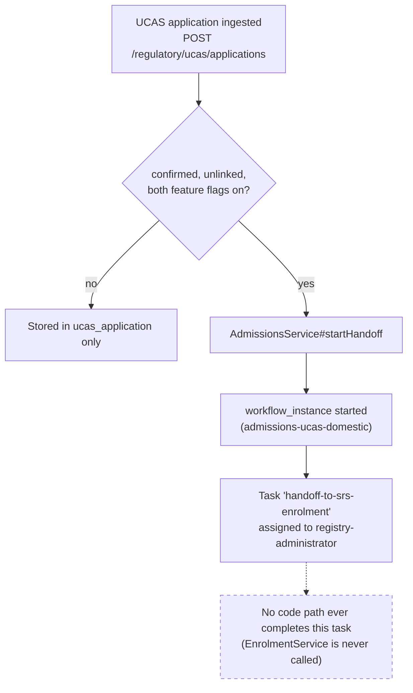

# A Guide to Recruitment and Admissions and Revelation SRS

> Audience: admissions/registry leads, product owners, and developers
> evaluating or extending Revelation SRS's admissions capability.
>
> Structure: Part 1 introduces recruitment and admissions as a UK
> higher-education institutional function. Part 2 describes, precisely and
> with explicit caveats about what's built versus designed, how Revelation
> SRS implements it.

## Part 1 — Recruitment and admissions as an institutional function

### The journey from applicant to student

Admissions is the process that turns an enquiry into an enrolled student. In
UK higher education it has a fairly consistent shape across institutions,
even though the entry points differ:

- **Application** — a prospective student applies, most commonly through
  **UCAS** (the centralised national applications service most undergraduate
  applicants use), but also **directly** to the institution (common for
  postgraduate study, some international applicants, and some undergraduate
  routes), through an **agent** acting on behalf of an international
  applicant, or later in the cycle through **Clearing** (the process that
  matches remaining applicants to remaining places once exam results are
  known).
- **Assessment** — the institution reviews the application against its
  entry criteria and makes a decision.
- **Offer** — conditional (dependent on achieving stated grades or other
  conditions) or unconditional. The offer is, in UK consumer-protection
  terms, close to a contractual proposal — the Competition and Markets
  Authority's guidance for higher education treats offer-making and
  condition-setting as consumer-facing commitments the institution must
  honour transparently.
- **Confirmation of conditions** — once results are known, the institution
  confirms whether conditions were met and the offer becomes a firm place.
- **Conversion to enrolment** — the accepted applicant becomes a student
  record the institution can register, teach, and assess — the boundary
  this guide's implementation section spends the most time on, because it's
  where Revelation SRS's own admissions work is least finished.

### CAS — a visa-compliance overlay, not a parallel process

For applicants who need a student visa, a **CAS (Confirmation of Acceptance
for Studies)** must be assigned before they can apply to UKVI. This isn't a
separate admissions pathway — it's an overlay on top of an ordinary offer,
with its own eligibility checks, a specific UKVI-facing data payload, and a
sponsor-reporting obligation once the CAS is used: an institution's Student
sponsor licence depends on getting this right, so CAS handling tends to be
one of the most carefully governed parts of admissions in practice.

### Why "channel-neutral" matters

A well-designed admissions capability treats UCAS, direct applications,
agent-submitted applications, international applications, and Clearing as
**different front doors into the same process**, not as separate systems
that happen to produce similar outcomes. That matters because the
downstream steps — assessment, offer, confirmation, conversion — should
behave identically regardless of which door an applicant came through; an
institution that hard-codes "UCAS is the process" ends up rebuilding the
same logic badly for every other route. Part 2 shows Revelation SRS was
explicitly designed around this principle — and shows exactly how far that
design has actually been built out versus how far it's still scaffolding.

---

## Part 2 — How Revelation SRS supports admissions

### In short: how much of this actually works today?

**One route — UCAS — is real and wired end to end. The other four are
architecturally equal but currently unimplemented.** `AdmissionsService`
(`apps/api/src/platform/admissions/admissions-service.ts`) is a genuinely
source-neutral command surface — its own doc comment states the intent
plainly: *"All five admission routes (UCAS domestic, direct domestic,
international direct, international agent, clearing) enter the same
command surface... UCAS is one adapter, not a process owner."* Five
workflow definitions exist in the database, seeded equally, all
`owner_module_code: 'admissions'`, sharing the same step/gateway template.
But grep the whole codebase for callers of `AdmissionsService#startHandoff`
and there is exactly **one**: `UcasService.ingestApplication`. No direct,
agent, international-direct, or Clearing adapter has been written — those
routes exist today only as a workflow definition, a feature flag (mostly
off by default), and a `sourceSystem` label on demo-data records with no
application behind them.

The diagram below traces the one route that *is* wired, exactly as far as
the code actually takes it — including where it currently stops:

### The one real integration: UCAS, precisely

`apps/api/src/platform/regulatory/ucas-service.ts` is a genuine, tested
service — but it's worth being precise about what it actually is: an
**inbound ingestion API**, not a live client of UCAS's own systems. Nothing
in this codebase makes an outbound network call to UCAS. `POST
/regulatory/ucas/applications` accepts a UCAS-shaped application payload,
validates it, and bitemporally upserts it into a `ucas_application` table
(closing the prior version, inserting a new one — the same pattern used
throughout this codebase for correction-without-overwrite). Every ingest is
recorded as an idempotent exchange via `RegulatoryExchangeService`, and a
`srs.regulatory.ucas-application-received` event is published.

**The admissions handoff only fires under specific conditions**: the
application's status must be `confirmed`, it must not already be linked to
an enrolment, and **two feature flags** must both be on
(`admissions.enabled`, `admissions.ucas-adapter.enabled` — both default
`on`). Only then does `ingestApplication` call
`AdmissionsService#startHandoff({ source: 'ucas', ... })`, which starts a
`workflow_instance` for `admissions-ucas-domestic`, records a
`confirmed-for-handoff` decision at gateway `G03`, and assigns a task at
step `handoff-to-srs-enrolment` to a `registry-administrator`.

**A telling piece of history**: a feature flag named
`admissions.legacy-ucas-auto-enrolment.enabled` exists, explicitly marked
`status: 'retired'` and kept "for audit," with the description: *"Retired
migration flag retained for audit; confirmed UCAS applications now use
Admissions workflow handoff rather than direct enrolment creation."* There
used to be a UCAS-only shortcut that created an enrolment directly; it was
deliberately retired in favour of routing every source, UCAS included,
through the same generic handoff — concrete evidence the "source-neutral"
design isn't just an aspiration written in a doc comment, it's something an
earlier shortcut was actively unwound to achieve.

The **outbound** side — confirming applications back to UCAS — is itself a
separate, workflow-gated action: `generateOutboundConfirmations` turns
pending downstream triggers into a confirmation payload, but sending it
requires a `regulatory-officer` to approve through the
`ucas-confirmation-submission-approval` workflow (the same
request/decide/approve pattern the workflow-engine guide describes for
HESA, OfS, SLC and UKVI). As with ingestion, there's no code here making an
outbound call to UCAS's own systems — the payload is generated and
recorded, ready for a real UCAS-facing adapter to transmit.

### The gap the business-process docs already admit to, confirmed in code

`docs/business-processes/01-recruitment-and-admissions/` is candid about
its own maturity — every one of its seven process docs is still `Status:
Draft`, `Owner: TBC`, with three open questions apiece and a specific,
named "Revelation" gap. Checking the actual schema confirms the most
consequential of these directly: **there is no `application`, `offer`, or
`clearing_*` table anywhere in `packages/db/src/schema/`.** The only
admissions-shaped record that exists is `ucas_application` itself — a
single row per UCAS application, not a source-neutral application model.
Offer conditions, per-condition evidence, and confirmation authority — the
subject of BP-01-003 and BP-01-004 — have no data model at all yet, not
even a partial one.

**The handoff task itself is never completed by any code path.** Once
`startHandoff` assigns the `handoff-to-srs-enrolment` task to a
registry administrator, nothing calls `completeWorkflowTask` for it and
nothing calls `EnrolmentService` to actually create the enrolment — despite
the task's own `configuration` JSON naming `'targetService': 'EnrolmentService'`
as the intent. A registry administrator can only interact with it through
the generic Task Inbox's opaque "Complete" action (see *A Guide to the
Workflow Engine and Revelation SRS*), which has no way to trigger an
enrolment creation — there is no dedicated decision page for this handoff,
unlike `ModuleRegistrationRequestsPage` for registration changes. This is
the concrete, current shape of BP-01-007's open question about "the
conversion boundary."

### CAS: the most mature part of admissions, with its own internal duality

Confirmation of Acceptance for Studies is, perhaps surprisingly, the
furthest-along piece of this domain — and it illustrates a pattern this
project has run into before (see the wellbeing guide's now-resolved
`support_outcome` story): **two separate, unbridged CAS models exist.**

- **`ukvi_cas_request`** — the older, simpler bitemporal record
  (`enrolmentId`, `casReference`, `statusCode`), surfaced in `UkviPage.tsx`'s
  existing CAS tab.
- **`cas_case`/`cas_eligibility_check`/`cas_assignment_version`/
  `sponsor_report_version`** — a genuinely richer, later model
  (`packages/db/src/schema/regulatory.ts`), with a code comment explaining
  the split directly: *"`ukvi_cas_request` stays as-is: `cas_case` is a
  separate governed aggregate. Eligibility checks, assignment versions and
  sponsor report versions are the evidence/decision trail `ukvi_cas_request`
  never captured."* This model is surfaced in `StudentDetailPage.tsx`'s CAS
  tab: open a case, record an eligibility check (against a named guidance
  version), record an assignment version (the exact CAS number and a hash
  of the assigned payload — so what was actually sent is reconstructable
  later), and record a sponsor-report version.

`docs/product/current-capabilities.md` confirms this precisely: *"`cas_case`
remains a separate aggregate from `ukvi_cas_request` (UkviPage's existing
CAS tab) — no bridge between the two yet."* Unlike `support_outcome`, this
duality has not been investigated or resolved as part of this session's
work — it's flagged here accurately, not fixed.

### Admin surfaces and who can act

- **`UcasPage.tsx`** — lists ingested UCAS applications (personal ID,
  cycle, status, linked enrolment) and hosts the outbound confirmation
  queue (**Approve**/**Reject** with a reason) for anyone holding
  `regulatory:decide`.
- **`StudentDetailPage.tsx`**'s CAS tab — the `cas_case` open/eligibility/
  assignment/sponsor-report flow described above.
- **`UkviPage.tsx`**'s separate, pre-existing CAS tab — the older
  `ukvi_cas_request` model.
- **No admin page exists** for a cross-source applications list, an offer
  workflow, a Clearing workspace, or a dedicated decision screen for the
  admissions handoff task.

### Roles in this domain

There is no `admissions:*` permission at all — access rides entirely on
pre-existing permissions from the regulatory domain. The BP-01-005
document's "International Compliance Officer" actor has no corresponding
role in `ROLES` — the nearest real role is `regulatory-officer`.

| Role | What they can do here |
|---|---|
| `registry-administrator` | Full `regulatory:read`/`write`/`decide`; the assignee for the (never-completed) admissions handoff task; opens and progresses `cas_case`s |
| `regulatory-officer` | `regulatory:decide` — approves the outbound UCAS confirmation submission; decides UKVI CAS submission requests |
| `dpo`, `tenant-administrator`, `system-administrator` | `regulatory:read`/`write` — broad visibility and data entry, no distinct admissions authority |
| *(none)* | No role holds a dedicated admissions or Clearing permission — none exists to hold |

There is no applicant-facing portal surface anywhere in `apps/portal/`.
Admissions in Revelation SRS is entirely staff/back-office, pre-enrolment —
consistent with the process docs' own framing, which treats the
prospective student as someone who interacts with UCAS or the institution's
admissions channel, not with SRS directly, until they become a student.

### Trying it: the applicant-pipeline demo scenario

`pnpm evaluate --scenario applicant-pipeline` (not the default — the
default is `module-selection`) loads **S1 — Applicant Pipeline**: 600
prospective-status persons distributed 70% UCAS / 10% direct / 10%
international / 5% agent / 5% clearing by source system — but, matching
everything above, **only the UCAS 70% actually get a `ucas_application`
row**; the other 30% carry a `sourceSystem` label with no application
record behind it, because no such table exists yet for them. UCAS
application statuses are spread across `submitted`/`under-review`/
`conditional`/`unconditional`/`rejected`. No CAS cases and no enrolments
are seeded by this scenario — it demonstrates "applicant with a UCAS-style
application," not the full pipeline through to an enrolled student (that
continuity lives in the separate `enrolment-induction` scenario, currently
unconnected to this one).

### What this means in practice

If you're evaluating Revelation SRS's admissions capability: the
architecture is genuinely designed for multi-channel admissions, and UCAS
is a faithful, tested demonstration of what a real adapter looks like end
to end — ingestion, idempotent exchange tracking, feature-flagged workflow
handoff, and a governed outbound confirmation approval. What isn't there
yet is everything downstream of "UCAS says this application is confirmed":
no offer/condition data model for any route, no adapters for the other
four sources, and no code that actually converts a confirmed application
into an enrolment. Building a direct-applications adapter would mean
following `UcasService`'s shape closely — but the enrolment-conversion gap
would need solving first, since every route's handoff currently ends at
the same unfinished step.
