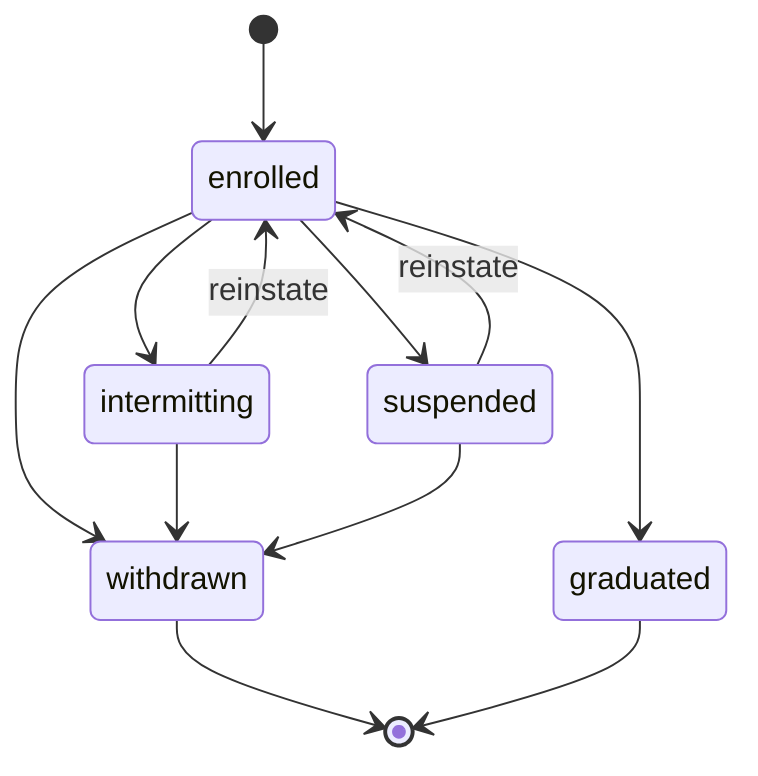

# A Guide to Registration and Student Status and Revelation SRS

> Audience: registry leads, product owners, and developers evaluating or
> extending Revelation SRS's registration and student-status capability.
>
> Structure: Part 1 introduces registration and student status as a UK
> higher-education institutional function. Part 2 describes, precisely and
> with explicit caveats about what's built versus designed, how Revelation
> SRS implements it.

## Part 1 — Registration and student status as an institutional function

### Becoming, and remaining, "a student"

Registration is the act that converts an accepted applicant into a
recognised, recorded student — and it isn't one event but several,
typically bundled together in an institution's mind even though they're
legally and administratively distinct: confirming **identity and
right-to-study** (including, for international students, immigration
compliance under a Student sponsor licence), completing **academic
registration** (agreeing the programme, mode, and terms), completing
**financial registration** (fee liability, funding source), and
**activating access** (the systems and entitlements a registered student
needs from day one).

Registration isn't a one-off either. A student's status changes throughout
their time at the institution — they may **interrupt** or **suspend**
their studies, **transfer** to a different programme, route, or mode,
**withdraw** entirely, or need to **re-register** each year to confirm
they're continuing. Eventually their record needs to be properly **closed**
as a leaver — whether because they graduated, withdrew, or simply never
completed registration in the first place. Each of these is its own
governed decision, often with its own actor (a personal tutor for an
interruption request, Student Finance for a financial-registration
implication, UKVI for anything affecting a visa) and its own downstream
consequence (access revoked, fee liability adjusted, a sponsor notified).

### Why status changes deserve real governance

A student's status is read by almost every other part of an SRS —
assessment eligibility, fee calculation, access entitlements, regulatory
returns, visa compliance — so a status change is rarely a purely
administrative edit. Getting it wrong has real consequences: withdrawing a
student incorrectly can cut off access to systems they still need; failing
to notify a sponsor of a status change affecting a visa can put an
institution's sponsor licence at risk. A well-designed system treats status
transitions as **governed events** — validated against what's actually
allowed from the current state, evidenced, and where appropriate,
approved by the right person — not just a field that gets overwritten.

---

## Part 2 — How Revelation SRS supports registration and student status

### In short: a clean, well-validated state machine — with almost no human governance around it yet

`EnrolmentService` (`apps/api/src/platform/enrolment/service.ts`) is small,
precise, and entirely built around one state machine:

Every one of these five arrows is reachable through one API call, gated by
a single flat permission — `enrolment:write`, held only by
`registry-administrator` — with no approval step of any kind in between.

Every transition — intermit, suspend, withdraw, graduate, or reinstate back
to `enrolled` — goes through one method, `transitionStatus`, which validates
the move against this matrix, closes the current bitemporal version and
inserts a new one, writes an append-only `enrolment_status_transition`
audit row, and publishes `srs.student.status-changed`. This is a genuinely
solid foundation: the *shape* of what's allowed is enforced centrally and
consistently, with a full history of every change.

**What's worth being direct about**: unlike almost every other governed
decision this guide series has covered, **none of these transitions go
through any approval workflow at all.** `EnrolmentService`'s constructor
takes a validator and a trigger evaluator — no `WorkflowBridgeService`.
A single permission, `enrolment:write`, held only by
`registry-administrator`, gates every one of the five transition routes.
Contrast this directly with the *identity-change* workflow (gender and
nationality changes to a person's identity record) — a real, working,
personal-tutor-approved request/decide flow, covered file-by-file in *A
Guide to the Workflow Engine and Revelation SRS* — which exists for a
narrower, arguably less consequential class of change than "this student is
now withdrawn." Today, interrupting, suspending, or withdrawing a student
is a single, unmediated API call by a registry administrator: no student
self-service request, no personal-tutor or finance sign-off, no deadline or
escalation.

### Identity and right-to-study — deliberately kept separate

The one place this domain is unambiguously careful is the separation
between **identity verification** and **immigration/right-to-study**
checking — exactly the boundary the underlying business process calls for.
`identity_verification_check` (`apps/api/src/platform/students/service.ts`
— `requestIdentityVerification`/`completeIdentityVerification`) is a
generic, provider-agnostic check (status, confidence score, fraud flag)
kept entirely apart from immigration status, which lives in
`UkviService` (`apps/api/src/platform/regulatory/ukvi-service.ts`) as three
genuinely separable capabilities:

- **CAS request generation and visa-status ingestion** — the operational
  side, raising a `ukvi_compliance_alert` when a visa is curtailed or
  refused.
- **A newer, richer, separately-governed CAS aggregate**
  (`cas_case`/`cas_eligibility_check`/`cas_assignment_version`/
  `sponsor_report_version`, covered in *A Guide to Recruitment and
  Admissions and Revelation SRS*) — explicitly documented as not yet
  bridged to the older `ukvi_cas_request` model.
- **Sponsor-compliance decisions**, which get real procedural rigour: a
  decision to report or not report a student to UKVI requires a separate
  authorising actor from the one who made the decision —
  `authoriseSponsorDecision` throws outright if `decision.decidedBy ===
  actorId`, a genuine four-eyes control, not just a documented expectation.

**A real gap worth naming plainly**: neither `createEnrolment` nor
`transitionStatus` ever checks `identity_verification_check` or
`ukvi_visa_status` state. Nothing in the service layer enforces the
precondition — central to how registration is meant to work — that
academic registration only completes once identity and right-to-study
checks have actually passed. If that gate exists at all today, it's a
matter of process, not code.

### What genuinely doesn't exist yet

Being precise about gaps matters as much as being precise about what
works, and this domain has several worth naming exactly:

- **Programme, route, or mode transfer has zero implementation.**
  `EnrolmentService` has no method to change a `programmeId`,
  `modeOfStudyCode`, or route — `transitionStatus` copies these fields
  through unchanged on every transition. There's no update route, no admin
  edit form, nothing. This isn't a partial or thin implementation; it's
  entirely absent. The business-process document for this exact process
  (BP-02-006) says so itself, more bluntly than almost any other doc in
  this whole guide series: *"Revelation workflows | Gap — no complete
  durable workflow."*
- **Annual re-registration is schema-only.** `reenrolment_period` and
  `reenrolment_confirmation` tables exist, bitemporal-shaped, verified by a
  migration test — but there is no service, no route, no admin or portal
  page, and no demo data populates them, so they sit permanently empty in
  a running instance. The domain-events catalogue lists
  `srs.student.re-enrolled` explicitly under "Backlog — Not Yet
  Implemented."
- **Resolving a failure to register (BP-02-011) and closing a leaver
  record (BP-02-012) have no implementation at all** — not thin, absent.
  There's no non-registration status taxonomy, no closure orchestration,
  and no entitlement-revocation sequence; a withdrawn student's record
  simply carries the `withdrawn` status with no further automated
  consequence beyond what `#updatePersonStatusFromEnrolments` does (below).
- **`student_hold` and `student_obligation`** — entities the business-process
  documents for interruption, withdrawal, re-registration, and closure all
  name as the mechanism for blocking a student's progress pending an
  outstanding requirement — **do not exist anywhere in the schema.**

None of this is an oversight this guide is uncovering for the first time —
it matches `docs/product/current-capabilities.md`'s own summary for this
capability precisely: *"Transfer, return, non-registration decision and
leaver closure cases are incomplete."* If anything, "incomplete" understates
transfer, re-registration, non-registration, and leaver closure, all four
of which have no implementation whatsoever rather than a partial one.

### What does happen automatically

`#updatePersonStatusFromEnrolments` is the one piece of real automatic
consequence in this domain: after every enrolment creation or status
transition, it recomputes the coarse, person-level status
(`prospective`/`student`/`alumnus`) from the set of that person's current
enrolment statuses — never overwriting a `deceased` or `merged` person
status. It's a genuinely useful, narrow piece of automation; it's also the
full extent of what happens automatically. It does nothing to access,
entitlements, documents, or retention.

### Admin and portal surfaces

**`StudentDetailPage.tsx`**'s `EnrolmentCard` is the entire status-change UI
surface: an expandable card per enrolment, with the five transition
actions available as buttons wherever the state machine allows them, each
behind a confirmation modal. There is no separate page for transfer,
interruption, return, re-registration, or leaver closure, because none of
those capabilities exist to have a page for. The portal's
`EnrolmentsPage.tsx`/`EnrolmentDetailPage.tsx` are read-only — a student
can see their status, programme, mode, and dates, but has no self-service
way to request an interruption, withdrawal, or transfer.

### Roles in this domain

| Role | What they can do here |
|---|---|
| `registry-administrator` | The only role that can change status — `enrolment:write` covers create and every transition; also `identity:manage` for right-to-study data |
| `student` | `enrolment:read:own` — can view, not change, their own status |
| `exam-board-chair`, `wellbeing-advisor`, `finance-administrator`, `external-examiner` | `enrolment:read:all` — full visibility, no write access at all |
| `personal-tutor` | `student:decide` — but only for the separate identity-change (gender/nationality) workflow, not status transitions |
| `regulatory-officer` | Decides UKVI right-to-study/sponsor-compliance actions — kept structurally apart from enrolment status itself |

No role holds anything finer-grained than the one flat `enrolment:write`
permission — there's no split between, say, who may action an
interruption versus a withdrawal.

### What this means in practice

If you're evaluating this capability: the core state machine — the part
that answers "what statuses exist and what transitions between them are
legal" — is solid, consistent, and fully audited. Almost everything around
it that a real registry team would expect — approval gating on
consequential changes, transfer between programmes, annual re-registration,
and structured handling of a leaver's record — is either thin or entirely
missing. This is one of the more honestly under-built domains in Revelation
SRS today, and the gap is exactly where the business-process documentation
already says it is.
