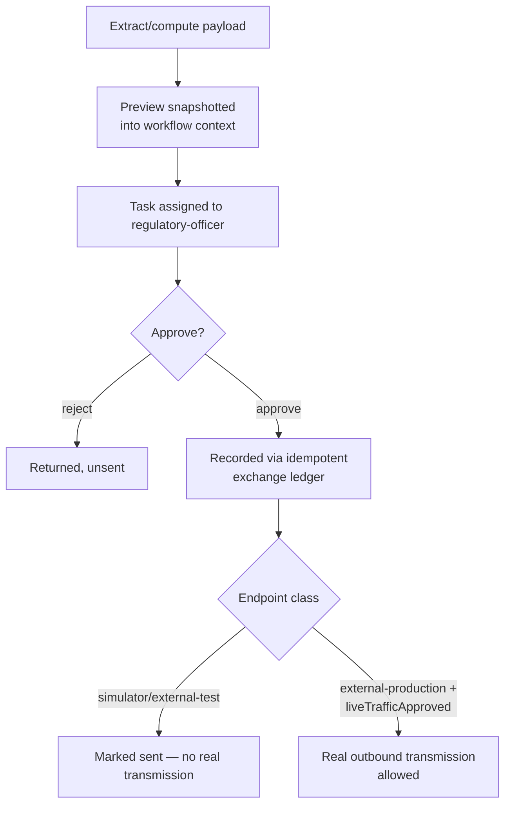

# A Guide to Regulatory and Statutory Reporting and Revelation SRS

> Audience: registry/compliance leads, product owners, and developers
> evaluating or extending Revelation SRS's regulatory reporting
> capability.
>
> Structure: Part 1 introduces regulatory and statutory reporting as a UK
> higher-education institutional function. Part 2 describes, precisely and
> with explicit caveats about what's built versus designed, how Revelation
> SRS implements it. The submission-approval workflows named here are
> covered file-by-file in *A Guide to the Workflow Engine and Revelation
> SRS* — this guide focuses on the regulatory substance, not the approval
> mechanics.

## Part 1 — Regulatory and statutory reporting as an institutional function

### An institution answers to more than one regulator, in more than one nation

UK higher education institutions report into a genuinely plural regulatory
landscape, and which bodies apply depends on where an institution sits:
**HESA** (the Higher Education Statistics Agency) collects the core annual
student data return used across the UK; **student finance bodies** (Student
Finance England, Wales, Scotland, Northern Ireland) need registration,
attendance, and status-change data to administer loans and grants;
**UCAS** needs confirmation of whether offer-holders actually enrolled;
**UKVI** requires ongoing compliance reporting for any institution
sponsoring international students' visas; and each nation has its own
funding/quality regulator — the **Office for Students** (England), the
**Scottish Funding Council**, **Medr** (the Commission for Tertiary
Education and Research, Wales), and the **Department for the Economy**
(Northern Ireland) — each with its own extract requirements.

### Why "submission" is rarely a single event

A statutory return is almost never a one-shot file transfer. It typically
involves extracting and validating data against the regulator's rules,
submitting a return, receiving a validation report back, correcting
flagged issues, and resubmitting — sometimes multiple rounds before a
return is accepted. Because these returns carry real regulatory and
funding consequences, most institutions treat the decision to submit as
something a specific, accountable person authorises — not something that
happens automatically the moment data looks ready.

---

## Part 2 — How Revelation SRS supports regulatory reporting

### In short: deep and real for five UK-wide bodies, a shared shell for the devolved-nation regulators

This domain is genuinely uneven, and — consistent with the rest of this
guide series — the codebase itself is honest about exactly where the line
sits. **HESA, OfS, UCAS, SLC, and UKVI** each have a dedicated,
substantial service, dedicated schema, and a dedicated admin page.
**Scotland's SFC, Wales's Medr, and Northern Ireland's DfE** have no
service, schema, or admin page of their own at all — they share one
generic, regulator-neutral model, described precisely below.

One fact applies uniformly across every regulator this domain covers, and
is worth stating up front so it doesn't need repeating five times: **no
service in this codebase makes a real outbound network call to an actual
external regulator.** "Submission," everywhere in this domain, means
generating and validating a payload, recording it through a shared,
idempotent internal exchange ledger, and a human marking it sent —
transport to the real external system is a deployment-time seam, not
something exercised in this codebase. The shared exchange service that
enforces this even has a built-in safety gate: it refuses to treat an
endpoint as safe for real outbound traffic unless it's explicitly
registered as `external-production` *and* the caller has set
`liveTrafficApproved: true` — every non-production registration defaults
to `simulator`.

The pattern every one of HESA, OfS, UCAS, SLC, and UKVI follows for its
approval-gated submission step:

### HESA — the deepest single implementation in this domain

`HesaService` runs a genuine extraction pipeline: a real SQL join across
enrolment, identity, and programme data, grouping multiple enrolments per
person the way HESA's own HUSID/MODS model requires, mapping the result
into HESA-coded fields — with an honest, explicit note in the code that
fields with no direct source in Revelation SRS are emitted as null "for
institutional completion," rather than being silently guessed at. Records
are validated against real rules (age, mode code, positive year-of-
programme, that a classification requires a qualification). The output is
literal, hand-rolled XML with a SHA-256 hash recorded against it — not a
live Jisc submission, but a genuine, inspectable file. HESA also supports
receiving a validation report back and generating amendments with full
diff tracking against the original submission — the closest thing this
domain has to the "submit, get corrections back, resubmit" cycle Part 1
describes.

### OfS — honest that there's no transmission step at all

`OfsService` computes real aggregate figures directly from source data —
continuation, completion, and progression rates for the B3 condition,
and participation segments (POLAR4, IMD, care-experienced, disability).
The code is explicit about a design decision worth quoting directly: OfS
"has no existing submit/transmit step at all (unlike SLC/HESA/UCAS/UKVI) —
the admin console's only further action after generation is a client-side
JSON download." Its approval workflow gates *generation*, not transmission
— because, in this codebase, there is no transmission step to gate.

### UCAS, SLC, and UKVI — confirmation flows and, for UKVI, real four-eyes governance

UCAS and SLC follow the same shape: pending downstream trigger records
(created elsewhere in the enrolment lifecycle — enrolment creation,
status changes) are turned into a scheme-specific confirmation payload,
recorded through the exchange ledger, and gated behind a submission-
approval workflow that deliberately snapshots the previewed record set
into the workflow's own context — an explicit fix, per the code, to an
earlier design where a preview and the eventual decision could silently
diverge.

UKVI is the deepest of the three, and the only one in this domain with a
genuine procedural control beyond a single approval gate: a sponsor-
compliance decision (report, don't report, or seek further review on a
student) requires an independent authorising actor — the same person who
made the decision is explicitly barred from authorising it, enforced in
code, not just policy. A once-real "generate an attendance report
directly" shortcut has been deliberately retired in favour of this
evidence-snapshot-then-decision-then-independent-authorisation chain — the
same kind of intentional hardening this guide series has already seen in
the admissions domain's retired UCAS auto-enrolment shortcut.

One duality worth naming here too, since it echoes a pattern this guide
series keeps encountering: a newer, richer CAS model
(`cas_case`/`cas_eligibility_check`/`cas_assignment_version`/
`sponsor_report_version`, covered in *A Guide to Recruitment and Admissions
and Revelation SRS*) exists alongside the older `ukvi_cas_request` model
UKVI's admin page still surfaces — the two are not yet bridged.

### Scotland, Wales, and Northern Ireland — a shared shell, not a gap in disguise

There is no SFC-, Medr-, or DfE-specific code anywhere in this codebase.
Instead, a single **regulator-neutral generic model** — a code comment
states this plainly: "HESA/OfS keep their bespoke tables and services;
this is the model SFC (Scotland), Medr (Wales) and DfE-NI collections use
directly." It gives every devolved-nation regulator the same generic
shape: open a collection, snapshot it, add records (as arbitrary JSON —
there's no HESA-style field-by-field mapping logic behind it), add
validation issues (free-text severity and message, no built-in rule set),
sign off (blocked only if a blocking-severity issue remains open), and
submit — recorded, again, with no automated extraction, no computed
metrics, and no file generation; every record and validation issue has to
be supplied by the caller. The admin surface for this reflects exactly
that genericness: a free-text regulator-code field, not fixed tabs for
SFC, Medr, or DfE — and, tellingly, the admin regulatory hub page that
lists HESA, UCAS, SLC, UKVI, and OfS as tiles doesn't include a tile for
any devolved-nation regulator at all; the generic collection page exists,
but isn't surfaced there as a peer.

### Resolving a data-quality issue — fragmented, not centralised

There's no dedicated mechanism for "trace a queried figure back to its
source and correct it at the right layer," the way this domain's own
process documentation describes. What exists instead is two narrower,
disconnected things: HESA's own bespoke amendment and diff-tracking
(real, but HESA-specific, and scoped to *that* return's lineage, not a
cross-regulator triage process), and the exam-board-gated
`CorrectionService` covered in *A Guide to Assessment and Results and
Revelation SRS* — which corrects marks, results, and progression
decisions, and has no awareness of regulatory submissions at all. A
generic validation-issue table exists as part of the devolved-nation
collection model, but nothing routes a flagged issue through
classification, correction, and re-verification.

### Roles and who decides

| Role | What they can do here |
|---|---|
| `regulatory-officer` | `regulatory:decide` — the assignee for all five submission-approval workflows (HESA, OfS, UCAS, SLC, UKVI); the only role dedicated to this domain |
| `registry-administrator` | `regulatory:read`/`write` — data entry and visibility across every regulator, including the generic devolved-nation collections |
| `dpo`, `tenant-administrator`, `system-administrator` | `regulatory:read`/`write` — broad visibility, no distinct authorisation role |

A single dedicated role does most of the work in this domain. All five
submission-approval workflows assign their decision task to
`regulatory-officer`, consistent with the workflow-engine guide's account
of how every one of these approvals actually runs — including the UKVI
sponsor-compliance decision's additional four-eyes rule that the deciding
actor cannot also authorise their own decision.

### What this means in practice

If you're evaluating this capability for an institution outside England:
be clear-eyed that HESA/OfS/UCAS/SLC/UKVI's depth doesn't extend to SFC,
Medr, or DfE today — those regulators get a genuinely usable, generic
collection-and-signoff shell, not their specific field formats or
validation rules, and the product's own capability tracking says so
without hedging. For any of the five UK-wide bodies, the extraction and
validation logic is real and worth trusting; the actual wire transmission
to the regulator is not — that boundary is consistent, deliberate, and
the same one this whole guide series has found throughout Revelation
SRS's regulatory integrations.
